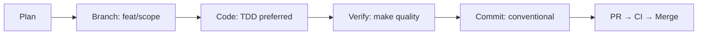

# Contributing to RMI (Rug Munch Intelligence)

Thank you for your interest in contributing. RMI is a multi-chain crypto intelligence platform
providing real-time scam detection, token security scanning, wallet analysis, and market intelligence
across 96+ blockchains.

## Quick Start

1. **Read `AGENTS.md` first** — contains architecture rules and development constraints.
2. Clone and set up:
   ```bash
   git clone https://git.rugmunch.io/RugMunchMedia/rmi-backend.git
   cd rmi-backend
   python3 -m venv .venv && source .venv/bin/activate
   pip install -r requirements.txt -r requirements-dev.txt
   ```
3. Run the quality gate:
   ```bash
   make quality
   ```
4. Read Architecture Decision Records at `docs/adr/`.

## Code Standards

See **[`docs/CODING_STANDARDS.md`](docs/CODING_STANDARDS.md)** for full reference.

| Check | Command | Requirement |
|-------|---------|-------------|
| Format | `ruff format app/` | Must pass |
| Lint | `ruff check --fix app/` | Zero errors |
| Types | `mypy app/ --strict` | Strict mode |
| Security | `bandit -r app/ -ll` | No high-severity |
| Tests | `pytest -v` | Must pass |
| Coverage | `pytest --cov=app --cov-fail-under=60` | ≥60% |
| Secrets | `gitleaks detect` | Zero findings |
| File size | No file > 500 lines | Split if exceeded |
| No `print()` | Use `from app.core.logging import get_logger` | Zero exceptions |
| No `time.sleep()` | Use `asyncio.sleep()` | Zero exceptions |
| Async I/O | `httpx.AsyncClient` for all HTTP | No sync requests |

## Architecture Decision Records

Key design decisions are in `docs/adr/`:

| ADR | Title | Status |
|-----|-------|--------|
| 001 | DataBus as the Single Data Layer | Accepted |
| 002 | Monolith over Microservices | Accepted |
| 003 | Redis for Hot Cache, Postgres for Cold | Accepted |
| 004 | Multi-Source Data Fusion for Risk Scoring | Accepted |
| 005 | x402 Payment-Gated API Access | Accepted |
| 006 | CI Quality Gates | Accepted |

## Development Flow



1. **Plan:** Review ADRs and architecture before coding.
2. **Branch:** `git checkout -b feat/your-change` (use `feat/`, `fix/`, `chore/`, `docs/`, `refactor/`, `test/`).
3. **Code:** Follow `docs/CODING_STANDARDS.md`. Write tests first (TDD preferred).
4. **Verify:** `make quality` — runs lint + typecheck + security + tests + coverage.
5. **Commit:** Conventional commits required.

## Quality Gate

Every push runs through our CI quality gates:

```
┌─────────┐  ┌──────────┐  ┌──────────┐  ┌────────┐  ┌──────────┐  ┌──────────┐
│ ruff    │  │ mypy     │  │ bandit   │  │ pytest │  │ coverage │  │ gitleaks │
│ lint    │  │ typecheck│  │ security │  │ tests  │  │ > 60%    │  │ secrets  │
└─────────┘  └──────────┘  └──────────┘  └────────┘  └──────────┘  └──────────┘
     │             │             │             │            │            │
     └─────────────┴──────┬──────┴─────────────┴────────────┴────────────┘
                          ▼
                 ✅ ALL MUST PASS
```

## PR Checklist

- [ ] Tests pass (`make test` / `make test-all`)
- [ ] Lint passes (`make lint`)
- [ ] Types pass (`make typecheck`)
- [ ] Security scan clean (`make security`)
- [ ] Coverage ≥ 60% (`make coverage`)
- [ ] Gitleaks clean (`gitleaks detect`)
- [ ] No `print()`, no `time.sleep()`, no f-string logs
- [ ] Async/await for all I/O
- [ ] File under 500 lines
- [ ] Docstrings on all public functions
- [ ] Error handling covers invalid input, external failure, timeout
- [ ] No secrets, API keys, or RPC URLs in code
- [ ] CHANGELOG updated if user-facing change
- [ ] ADR updated if architecture decision changed

## Container Standards

```yaml
# Every container MUST use:
services:
  <service>:
    restart: unless-stopped
    security_opt:
      - no-new-privileges:true
    cap_drop:
      - ALL
    read_only: true
    healthcheck:
      test: ["CMD", "curl", "-sf", "http://localhost:<port>/health"]
```

## Where to Add Code

| Component | Location | Notes |
|-----------|----------|-------|
| New domain module | `app/domains/<domain>/` | DDD structure |
| New middleware | `app/middleware_setup.py` | Register in `register_middleware()` |
| New data source | `app/databus/providers/` | Register in `chains.py` |
| New scanner | `app/scanners/` | Add to SENTINEL pipeline |
| New endpiont | create module + add to `app/mount.py` | Never add to `main.py` |
| API contract | `docs/API.md` | Keep in sync with OpenAPI spec |

## Questions

Open a Forgejo issue or discussion at `git.rugmunch.io/RugMunchMedia/rmi-backend`.

---

*Last updated: 2026-07-25*
