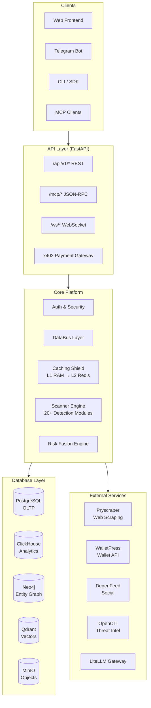
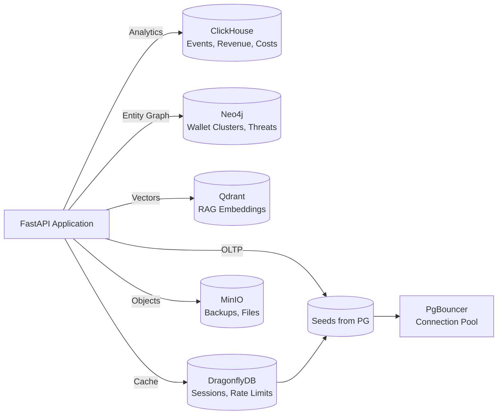
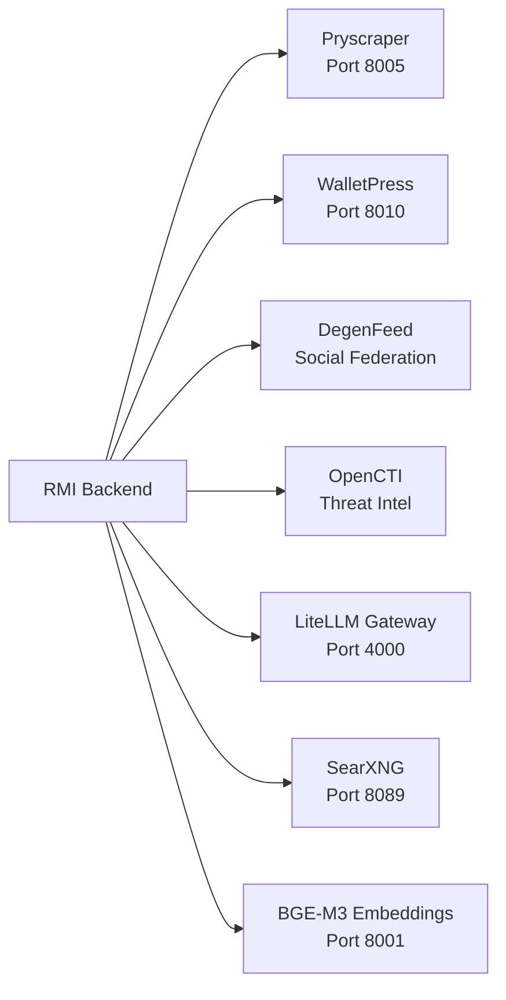
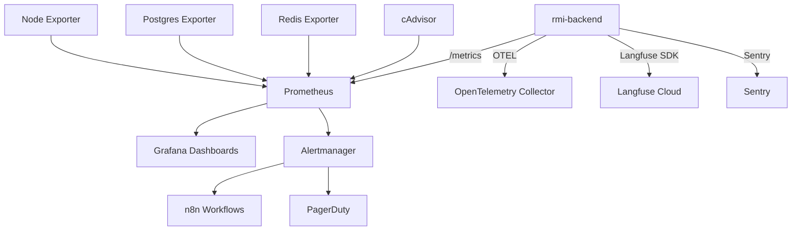
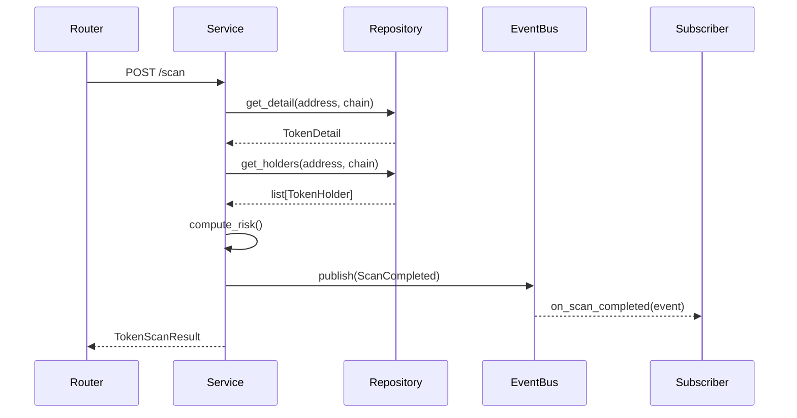

# RMI Backend — System Architecture

> **Version:** 2026.06.21 | **Last updated:** 2026-07-23

---

## 1. System Overview

Rug Munch Intelligence (RMI) is an institutional-grade crypto intelligence platform purpose-built for scam detection, wallet intelligence, and on-chain threat analysis. The platform provides 200+ tools across 9 provider categories, covering 13+ blockchain networks and integrating 96+ data providers.

**What RMI does:**

- **Token Risk Scoring** — Multi-source fusion analysis combining on-chain data, social signals, market metadata, and deployer reputation to produce a unified risk score
- **Wallet Intelligence** — Portfolio tracking, PnL analysis, clustering (Neo4j), funding source tracing, and entity resolution
- **Security Scanning** — Honeypot detection, rug-pull analysis, contract audit, deployer history, and insider network detection
- **Market Data** — Real-time token prices, liquidity analysis, volume trends, arbitrage detection, and DeFi TVL verification
- **Social Signals** — Sentiment analysis, KOL tracking, profile manipulation detection, and social velocity metrics
- **Threat Intelligence** — Phishing domain monitoring (CertStream), criminal cluster detection, impersonation forensics
- **x402 Micropayments** — Pay-per-request premium data access via on-chain USDC across 8 chains with instant settlement



---

## 2. Tech Stack

| Component | Technology | Purpose |
|-----------|-----------|---------|
| **Runtime** | Python 3.11+, FastAPI (async) | Web framework |
| **Primary DB** | PostgreSQL 16 (SQLAlchemy 2.0 async) | Relational OLTP |
| **Connection Pooler** | PgBouncer | Postgres connection pooling |
| **Analytics DB** | ClickHouse 26.6 | Time-series events, scanner results |
| **Graph DB** | Neo4j 5 Enterprise | Entity resolution, wallet clustering |
| **Vector DB** | Qdrant 1.18 | Embeddings, semantic search |
| **Cache** | DragonflyDB 1.39 (Redis-compatible) | Low-latency caching |
| **Object Store** | MinIO | S3-compatible storage |
| **Workflow Engine** | Temporal.io | Durable background jobs |
| **LLM Gateway** | LiteLLM | Multi-provider AI routing |
| **Observability** | OpenTelemetry, Langfuse, Prometheus, Grafana | Tracing, metrics, dashboards |
| **Container** | Docker, Docker Compose | Deployment |
| **DNS** | dnsmasq | Internal DNS caching |

---

## 3. Directory Structure

```
rmi-backend/
├── app/                              # Main application package
│   ├── main.py                       # Entrypoint → factory.create_app()
│   ├── factory.py                    # App factory (composition root)
│   ├── mount.py                      # Router mounting (single source of truth)
│   ├── middleware_setup.py           # Middleware registration
│   ├── error_handlers.py             # RFC 7807 error handlers
│   ├── lifespan.py                   # Startup/shutdown lifecycle
│   ├── config.py                     # Pydantic-settings configuration
│   ├── api/                          # API layer
│   │   ├── deps.py                   # Shared FastAPI dependencies
│   │   ├── v1/                       # Versioned API routes
│   │   │   ├── auth/                 #   Auth endpoints
│   │   │   ├── public/               #   Wallet & token public endpoints
│   │   │   ├── rag/                  #   RAG search
│   │   │   ├── admin/                #   Admin endpoints
│   │   │   ├── mcp/                  #   MCP protocol handler
│   │   │   ├── catalog/              #   Service catalog
│   │   │   ├── internal/             #   Internal service endpoints
│   │   │   └── x402/                 #   x402 payment endpoints
│   │   └── ws/                        # WebSocket endpoints
│   ├── core/                         # Cross-cutting concerns
│   │   ├── auth.py                   #   Auth middleware
│   │   ├── config.py                 #   Settings
│   │   ├── errors.py                 #   AppError hierarchy
│   │   ├── logging.py                #   Structured logging
│   │   ├── metrics.py                #   Prometheus metrics
│   │   ├── problem_details.py        #   RFC 7807 helper
│   │   ├── tracing.py                #   OpenTelemetry
│   │   ├── slowrate.py               #   Rate limiter instance
│   │   ├── health_route.py           #   Health endpoints
│   │   ├── redis.py                  #   Redis client
│   │   ├── db.py                     #   SQLAlchemy engine
│   │   ├── degradation.py            #   Degraded store tracking
│   │   └── observability.py          #   Sentry integration
│   ├── domains/                      # Domain-driven design modules
│   │   ├── auth/                     #   JWT, OAuth, passwords, TOTP, wallet auth
│   │   ├── billing/                  #   x402 payment facilitators (8 chains)
│   │   │   ├── x402/                 #     x402 tools, pricing, enforcement
│   │   │   └── facilitators/         #     Payment processor implementations
│   │   ├── databus/                  #   Unified data layer (96+ providers)
│   │   │   ├── providers/            #     Individual provider implementations
│   │   │   └── _generated/           #     Auto-generated provider chains
│   │   ├── labels/                   #   Wallet label resolution
│   │   ├── news/                     #   News aggregation & clustering
│   │   ├── reports/                  #   Investigation report generation
│   │   ├── scanner/                  #   Token scanning engines & fusion
│   │   │   ├── engines/              #     Data source engines
│   │   │   └── modules/              #     Detection modules
│   │   ├── scanners/                 #   20+ individual scanner modules
│   │   ├── telegram/                 #   Telegram bot infrastructure
│   │   │   ├── rugmunchbot/          #     Customer-facing bot
│   │   │   └── adminbot/             #     Admin operations bot
│   │   ├── threat/                   #   CertStream phishing monitoring
│   │   ├── token/                    #   Token analysis & repository
│   │   ├── wallet/                   #   Wallet analysis & clustering
│   │   └── x402/                     #   x402 middleware & tools
│   ├── models/                       # SQLAlchemy ORM models
│   │   ├── base.py                   #   TimestampMixin
│   │   ├── user.py                   #   users table
│   │   ├── token.py                  #   tokens table
│   │   ├── scan.py                   #   scan_results table
│   │   ├── alert.py                  #   alerts + alert_subscriptions
│   │   ├── payment.py                #   payments table
│   │   └── label.py                  #   labels table
│   ├── services/                     # Business services
│   │   ├── deep_intelligence/        #   Deep intel analyzers (15+)
│   │   ├── prediction_market_intel.py #   Prediction markets
│   │   └── supabase_rag.py           #   Supabase RAG integration
│   ├── middleware/                   # Custom middleware
│   │   └── cost_tracking.py          #   Per-route cost tracking
│   ├── agents/                       # AI agent integration
│   ├── caching_shield/               # Multi-layer caching layer
│   ├── observability/                # Langfuse tracer
│   ├── rag/                          # RAG system
│   ├── routers/                      # Legacy & utility routers (mount.py)
│   ├── workers/                      # Background workers
│   └── billing/                      # Payment/billing helpers
├── alembic/                          # Database migrations
│   ├── env.py
│   └── versions/                     # Migration scripts
├── tests/                            # pytest test suite
├── docs/                             # Documentation
│   ├── adr/                          # Architecture Decision Records
│   ├── ARCHITECTURE.md               # This file
│   ├── API.md                        # API reference
│   ├── DATABASE.md                   # Database reference
│   └── DEPLOYMENT.md                 # Deployment guide
├── docker/                           # Docker configs
├── infra/                            # Infrastructure configs
│   ├── clickhouse_schema.sql
│   ├── alert_rules.yml
│   └── litellm-config.yaml
├── scripts/                          # Utility scripts
├── Dockerfile                        # Single-stage build
├── Dockerfile.multistage             # Multi-stage build (production)
├── Dockerfile.worker                 # Worker image
├── Makefile                          # Build/lint/test commands
├── pyproject.toml                    # Project + tool config
├── main.py                           # Legacy entrypoint
└── worker.py                         # Background worker entrypoint
```

---

## 4. Domain-Driven Design

The codebase is organized around business domains under `app/domains/`. Each domain is self-contained with its own models, services, and (where applicable) API routes.

| Domain | Module | Responsibility |
|--------|--------|---------------|
| **Auth** | `app/domains/auth/` | JWT issuance/verification, OAuth, password hashing (Argon2), TOTP, wallet signature auth, rate-limited login |
| **Billing** | `app/domains/billing/` | x402 payment protocol, 8 payment facilitators (Base, Solana, Ethereum, BSC, TRON, Bitcoin, Polygon, Arbitrum), pricing catalog, enforcement |
| **DataBus** | `app/domains/databus/` | Unified data access layer: provider selection, fallback chains, circuit breakers, 3-tier caching, 96+ providers across 13+ chains |
| **Labels** | `app/domains/labels/` | Wallet label resolution from internal DB + external sources (Etherscan, Chainbase, MetaSleuth, OpenLabels) |
| **News** | `app/domains/news/` | Multi-source news aggregation, clustering, sentiment analysis, admin management |
| **Reports** | `app/domains/reports/` | AI-generated investigation reports with citation validation |
| **Scanner** | `app/domains/scanner/` | Token scanning engines: multi-engine fusion, entity graph, insider detection, deployer reputation, market data, RAG scam check |
| **Scanners** | `app/domains/scanners/` | 20+ individual detection modules (honeypot, bundle detector, wash trading, flash loan, MEV, governance attack, etc.) |
| **Telegram** | `app/domains/telegram/` | Two Telegram bots: rugmunchbot (customer-facing) and adminbot (ops terminal) |
| **Threat** | `app/domains/threat/` | CertStream real-time phishing domain monitoring |
| **Token** | `app/domains/token/` | Token metadata, analysis service, repository |
| **Wallet** | `app/domains/wallet/` | Wallet analysis, clustering (Neo4j), fund flow tracing, entity resolution |
| **x402** | `app/domains/x402/` | x402 middleware (402 interception), tool dispatcher, premium tools |

### Cross-Cutting Layers

Layered above domains:

- **`app/core/`** — Auth middleware, AppError hierarchy, logging, metrics, tracing, rate limiting, health checks
- **`app/api/`** — Route definitions that delegate to domain services
- **`app/mount.py`** — Single source of truth for all router registrations

---

## 5. API Design

### Router Architecture

All routes are declared in `app/mount.py` through a declarative `ROUTER_MODULES` list. Each module is auto-discovered and mounted via `app.include_router()`. Adding a new domain requires only:

1. Create the module with a `router = APIRouter(...)` attribute
2. Add its import path to `ROUTER_MODULES`
3. The factory picks it up automatically

**Path conventions:**

| Prefix | Purpose | Status |
|--------|---------|--------|
| `/api/v1/*` | Current API version | ✅ Stable |
| `/` (root) | Legacy routes (deprecated) | ⚠️ Sunset 2026-10-17 |
| `/mcp/*` | MCP JSON-RPC protocol | ✅ Stable |
| `/ws/*` | WebSocket connections | ✅ Stable |
| `/health`, `/live`, `/ready` | Infrastructure probes | ✅ Stable |
| `/metrics` | Prometheus metrics | ✅ Internal |

### Error Handling

All errors use **RFC 7807 Problem Details** format:

```json
{
  "type": "https://docs.rugmunch.io/errors/auth.invalid_token",
  "title": "Invalid authentication token",
  "status": 401,
  "detail": "Token has expired or is malformed",
  "code": "auth.invalid_token",
  "instance": "/api/v1/wallet/0x.../balance",
  "request_id": "abc-123-def"
}
```

**Error hierarchy:**

```
AppError (base, status_code=500)
├── AuthError (401)
│   ├── AuthorizationError (403)
├── ValidationError (422)
├── NotFoundError (404)
├── ExternalAPIError (502)
├── UpstreamError (503)
└── ServiceUnavailableError (503)
```

### Middleware Pipeline (execution order)

1. **Request ID + Timing** — Injects `X-Request-ID` and `X-Response-Time-Ms` headers
2. **CORS** — Strict allowlist configured via `CORS_ORIGINS` (no wildcard in production)
3. **API Key Auth** — Validates `X-API-Key` header (internal services)
4. **Security Headers** — HSTS, CSP, X-Frame-Options, X-Content-Type-Options, Referrer-Policy, Permissions-Policy
5. **Prometheus Metrics** — Request count, duration, error rate per route
6. **Cost Tracking** — Per-tenant/per-route cost attribution
7. **OpenTelemetry Tracing** — Distributed tracing (gated by `OTEL_ENABLED`)
8. **Degradation Header** — Injects `X-Degraded-Stores` when data sources are unavailable
9. **Deprecation Header** — Adds `Deprecation` + `Sunset` on legacy root-level routes
10. **SlowAPI Rate Limiting** — Token bucket per IP per path category
11. **CSRF Protection** — Double-submit cookie pattern (exempts x402 + bearer auth)

---

## 6. Database Architecture

RMI uses **5 database engines** + **1 object store**, each chosen for a specific workload pattern.



| Engine | Purpose | Key Data |
|--------|---------|----------|
| **PostgreSQL 16** | Primary OLTP — source of truth | Users, tokens, scan results, alerts, payments, labels |
| **ClickHouse** | Time-series analytics | Revenue events, MCP call metrics, cost attribution, reputation deltas |
| **Neo4j 5 Enterprise** | Graph entity resolution | Wallet clusters, fund flow paths, threat actor networks |
| **Qdrant** | Vector similarity search | RAG document embeddings, code patterns, semantic search |
| **DragonflyDB** | In-memory cache | L2 cache (L1 is Python dict), sessions, rate limit buckets, pub/sub |
| **MinIO** | S3-compatible object store | Database backups, file uploads, RAG documents, static assets |

See [`DATABASE.md`](DATABASE.md) for full schema details.

---

## 7. Service Integration



### Pryscraper
- **Role**: Web scraping with Cloudflare bypass (FlareSolverr)
- **Location**: `pry` container, port 8005, its own Redis + Postgres
- **Integration**: RMI calls Pryscraper for intelligence gathering from protected websites
- **Compose**: `/srv/pry/docker-compose.yml`

### WalletPress
- **Role**: Wallet intelligence and management API
- **Location**: `backend-walletpress-1`, port 8010
- **Integration**: RMI consumes wallet risk scoring, portfolio tracking, analytics

### DegenFeed
- **Role**: Social media federation suite
- **Services**: GoToSocial (microblogging), Lemmy (forum), Bluesky PDS, Postiz (scheduling), RSS-Bridge, PeerTube
- **Integration**: RMI publishes alerts and content through n8n workflows

### OpenCTI
- **Role**: Threat intelligence platform
- **Location**: `opencti` stack, port 8095
- **Integration**: RMI pushes threat indicators, consumes enriched threat data
- **Connectors**: MITRE ATT&CK, STIX import/export, YARA rules, document analysis

### LiteLLM
- **Role**: LLM API gateway/proxy
- **Integration**: Multi-provider routing (OpenAI, Anthropic, OpenRouter), cost tracking, failover

---

## 8. Security Model

### Authentication
| Method | Use Case | Implementation |
|--------|----------|---------------|
| JWT (RS256) | User-facing API | `app/domains/auth/jwt.py` — generated on login, verified on every request |
| X-API-Key | Service-to-service | `app/core/auth.py` — validates `RMI_AUTH_TOKEN` or `ADMIN_API_KEY` |
| x402 Payment Proof | Premium endpoints | On-chain USDC tx hash in `X-Payment-Proof` header |
| Cookie Session | Web UI | Double-submit CSRF cookie pattern |

### Rate Limiting
- **Engine**: SlowAPI (token bucket per IP)
- **Auth endpoints**: 5 req/min per IP (brute-force protection)
- **Free tier**: 10 req/min per API key
- **Premium**: 100 req/min per API key
- **Public**: 30 req/min per IP

### Request Security
- **CORS**: Strict allowlist, no wildcard in production (`CORS_ORIGINS`)
- **CSRF**: Double-submit cookie pattern, skipped for Bearer auth + x402 endpoints
- **HSTS**: max-age=31536000, includeSubDomains, preload
- **CSP**: `default-src 'self'` for API, relaxed for docs
- **X-Frame-Options**: DENY
- **X-Content-Type-Options**: nosniff

### Container Security
- **Read-only root filesystem** (`read_only: true`)
- **No new privileges** (`no-new-privileges:true`)
- **All capabilities dropped** (`cap_drop: ALL`)
- **Non-root user** (rmi user)
- **Tini as PID 1** (proper signal handling, zombie reaping)
- **Secrets via env_file** (`.env.secrets`, never committed)

---

## 9. Deployment

RMI runs as a Docker container on a production VPS:

| Property | Value |
|----------|-------|
| **API Port** | 8000 |
| **Resource Limits** | 2 CPU, 2 GB RAM |
| **Build** | Multi-stage Dockerfile (`Dockerfile.multistage`) |
| **Entrypoint** | Tini → `python -u main.py` |

**Deploy flow:**
```bash
docker build -f Dockerfile.multistage -t backend-rmi-backend:latest .
docker compose up -d rmi-backend
```

See [`DEPLOYMENT.md`](DEPLOYMENT.md) for full deployment procedures.

---

## 10. Monitoring & Observability



| Component | Purpose | Port |
|-----------|---------|------|
| **Prometheus** | Metrics collection & alert evaluation | 9091 |
| **Grafana** | Dashboards, SLO tracking | 3000 |
| **Alertmanager** | Alert dedup & routing | 9093 |
| **Node Exporter** | Host metrics (CPU, memory, disk) | — |
| **Postgres Exporter** | Query performance, connections | — |
| **Redis Exporter** | Cache hit rate, memory usage | — |
| **cAdvisor** | Container resource usage | 8083 |
| **Langfuse** | LLM tracing & cost tracking | Cloud |
| **Uptime Kuma** | HTTP/TCP uptime monitoring | 3001 |
| **SonarQube** | Code quality static analysis | 9100 |

---

## 11. Key Architectural Decisions (ADRs)

Architecture Decision Records are maintained in [`docs/adr/`](adr/).

| ADR | Title | Status | Summary |
|-----|-------|--------|---------|
| **ADR-001** | DataBus as Single Data Layer | ✅ Accepted | All data access through `domains/databus/`. Products never call APIs directly. 3-layer caching, provider fallback chains, circuit breakers. |
| **ADR-002** | Monolith over Microservices | ✅ Accepted | Stay monolithic with organized modules. Single deployable container. Revisit at 3+ developers. |
| **ADR-003** | Redis for Hot Cache, Postgres for Cold | ✅ Accepted | Dual-write pattern. Redis for sub-ms lookups (TTL-based). Postgres as source of truth. |
| **ADR-004** | Multi-Source Data Fusion | ✅ Accepted | Risk scoring via weighted fusion of 7+ independent sources. Veto rule for critical signals. Confidence degradation tracking. |
| **ADR-005** | x402 Payment-Gated API | ✅ Accepted | HTTP 402 micropayments with on-chain USDC verification. 8 payment facilitators with automatic fallback. |
| **ADR-006** | CI Quality Gates | ✅ Accepted | Four blocking gates: ruff, mypy, bandit, pytest. Pre-commit hooks via lefthook. `continue-on-error: true` banned. |

---

## 12. Architecture Principles

1. **DataBus is the only data layer** — No service calls external APIs directly. All data flows through `databus.fetch()` with caching, rate limiting, and provider fallback.

2. **Single deployable** — Monolith before microservices. Modular code, single container. Revisit at 3+ developers.

3. **Strangler fig migration** — Legacy root-level routes coexist with `/api/v1/*` equivalents during a 90-day sunset window.

4. **RFC 7807 everywhere** — Every error response uses Problem Details format. No ad-hoc error structures.

5. **Isolated initialization** — Every middleware, router, and lifespan step is wrapped in try/except. One failure never blocks startup.

6. **Security at every layer** — CORS → Auth → CSRF → Rate limiting → Container isolation. Defense in depth.

7. **Observability by default** — Every request gets an ID, timing header, and Prometheus metric. Errors always reach Sentry. Langfuse traces LLM calls.

8. **Read-only by default** — Containers run with `read_only: true`, all capabilities dropped. Writes go to explicit tmpfs mounts.

---

## 13. Design Patterns

Design Patterns and conventions are documented in [`DESIGN_PATTERNS.md`](DESIGN_PATTERNS.md).

### Key additions (2026-07-24)

| Pattern | Module | Purpose |
|---------|--------|---------|
| **Event Bus** | `app/core/events.py` | Async pub/sub for decoupled service communication. Standard events: `ScanCompleted`, `WalletUpdated`, `NewsIngested`, `AlertTriggered`, `PaymentReceived`. Backed by Redis pub/sub with in-process subscriber fallback. |
| **CQRS** | `app/core/cqrs.py` | Command/Query separation for complex operations. Commands return result/error, queries return data. Mediator pattern dispatches to registered handlers. |
| **Repository** | `domains/*/repository.py` | All data access through repositories. No raw SQL in routers. Repositories return domain models, not raw dicts. |
| **Service Layer** | `core/base_service.py` | Standard CRUD interface (`list`, `get`, `create`, `update`, `delete`) with typed error helpers. All domain services inherit from `BaseService[T]`. |

### Cross-domain communication flow



### Identified cross-domain violations

The following modules have inverted dependencies (domain importing from routers).
These SHOULD be refactored per the plan in `DESIGN_PATTERNS.md §3.3`:

- `domains/billing/x402/` imports from `routers.x402_enforcement`
- `domains/billing/x402/` imports from `routers.x402_dashboard`
- `domains/x402/middleware.py` imports from `routers.x402_enforcement`
- `domains/billing/x402/` imports from `routers._expanded_tools`
