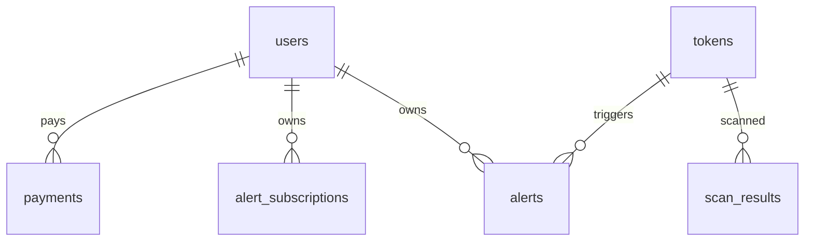

# RMI Fleet Database Schema Reference

> **Last updated:** 2026-07-24  
> **Scope:** All 5 primary databases in the Rug Munch Media production fleet  
> **File:** SCHEMA.md — infrastructure reference, not application code  
> **Cross-reference:** See `ARCHITECTURE.md` for service topology, `catalog/models.py` for Pydantic models

---

## Table of Contents

1. [PostgreSQL (Primary OLTP)](#1-postgresql-primary-oltp)
2. [ClickHouse (Analytics OLAP)](#2-clickhouse-analytics-olap)
3. [Neo4j (Graph — Entity Resolution)](#3-neo4j-graph--entity-resolution)
4. [Qdrant + ANN Index (Vector Search)](#4-qdrant--ann-index-vector-search)
5. [Redis / DragonflyDB (Cache + Queue + Pub/Sub + Graph)](#5-redis--dragonflydb-cache--queue--pubsub--graph)
6. [Cross-Store Reference Summary](#6-cross-store-reference-summary)
7. [Backup Strategy](#7-backup-strategy)

---

## 1. PostgreSQL (Primary OLTP)

| Property | Value |
|----------|-------|
| **Container** | `rmi-postgres` |
| **Image** | `postgres:16-alpine` |
| **Port** | `5432` |
| **Host** | `rmi-postgres` (Docker), `talos.rugmunch.io` (external) |
| **Database** | `rmi` |
| **User** | `rmi` |
| **Connection** | `DATABASE_URL` / `ALEMBIC_DATABASE_URL` env var |
| **Pool** | asyncpg pool (min 1, max 8), command timeout 10s |
| **ORM** | SQLAlchemy 2.0 `DeclarativeBase` + `TimestampMixin` |
| **Migrations** | Alembic (`alembic/versions/`) |
| **Backup** | Daily `pg_dump` to R2 |

### Schema Divergence Warning

> **⚠️ THERE ARE TWO SEPARATE SCHEMAS for `tokens` and `alerts` tables.** The ORM models (`app/models/`) define a different schema from the catalog tables (`app/catalog/init_schema.py`). See Alembic migration `75c982fccbb8` for details. The ORM models (alembic-managed) use `UUID` PKs with different columns. The catalog tables use `TEXT` PKs (`chain:address` convention). Access paths:
> - **ORM tables**: accessed through SQLAlchemy models (`app.models.*`)
> - **Catalog tables**: accessed through `CatalogService` (`app/catalog/service.py`) via asyncpg

### ORM-Managed Tables (Alembic)

All tables use `UUID` primary keys and inherit `TimestampMixin` (`created_at`, `updated_at` with timezone).

Managed exclusively by Alembic in `MODEL_TABLES`:
`users`, `tokens`, `alerts`, `alert_subscriptions`, `labels`, `scan_results`, `payments`

#### `users` — platform users

| Column | Type | Constraints |
|--------|------|-------------|
| `id` | `UUID` | PK, default `uuid4()` |
| `email` | `VARCHAR(320)` | UNIQUE, INDEX, nullable |
| `wallet_address` | `VARCHAR(128)` | UNIQUE, INDEX, nullable |
| `role` | `VARCHAR(32)` | DEFAULT `'USER'`, NOT NULL |
| `tier` | `VARCHAR(32)` | DEFAULT `'free'`, NOT NULL |
| `xp` | `INTEGER` | DEFAULT `0`, NOT NULL |
| `level` | `INTEGER` | DEFAULT `1`, NOT NULL |

#### `tokens` — token contract registry (ORM schema)

| Column | Type | Constraints |
|--------|------|-------------|
| `id` | `UUID` | PK |
| `address` | `VARCHAR(256)` | INDEX, NOT NULL |
| `chain` | `VARCHAR(32)` | DEFAULT `'solana'`, NOT NULL |
| `name` | `VARCHAR(256)` | DEFAULT `''` |
| `symbol` | `VARCHAR(64)` | INDEX |
| `decimals` | `INTEGER` | DEFAULT `9` |
| `total_supply` | `FLOAT` | DEFAULT `0.0` |
| `circulating_supply` | `FLOAT` | DEFAULT `0.0` |
| `holders` | `INTEGER` | DEFAULT `0` |
| `verified` | `BOOLEAN` | DEFAULT `false` |
| `risk_score` | `INTEGER` | DEFAULT `0` |
| `risk_level` | `VARCHAR(16)` | DEFAULT `'low'` |
| `extra` | `JSON` | nullable |

**Indexes:**
- `UNIQUE(chain, address)` → `uq_token_chain_address`
- `ix_token_symbol` on `(symbol)`
- `ix_token_verified` on `(verified)`
- `ix_token_chain_verified` on `(chain, verified)`
- `ix_token_chain_risk` on `(chain, risk_level)`

#### `scan_results` — token safety scan results

| Column | Type | Constraints |
|--------|------|-------------|
| `id` | `UUID` | PK |
| `token_address` | `VARCHAR(256)` | INDEX, NOT NULL |
| `chain` | `VARCHAR(32)` | NOT NULL |
| `symbol` | `VARCHAR(64)` | DEFAULT `''` |
| `name` | `VARCHAR(256)` | DEFAULT `''` |
| `safety_score` | `INTEGER` | DEFAULT `50` |
| `risk_score` | `INTEGER` | DEFAULT `0` |
| `risk_level` | `VARCHAR(16)` | DEFAULT `'low'` |
| `risk_flags` | `JSON` | NOT NULL |
| `warnings` | `JSON` | NOT NULL |
| `modules_run` | `JSON` | NOT NULL |
| `extra` | `JSON` | nullable |
| `scanned_at` | `TIMESTAMPTZ` | NOT NULL |
| `tier_required` | `VARCHAR(16)` | DEFAULT `'free'` |
| `confidence` | `INTEGER` | DEFAULT `0` |

**Indexes:**
- `ix_scan_result_token_chain` on `(token_address, chain)`
- `ix_scan_result_scanned_at` on `(scanned_at)`
- `ix_scan_result_risk_level` on `(risk_level)`
- `ix_scan_result_chain_risk` on `(chain, risk_level)`
- `ix_scan_result_tier` on `(tier_required)`

#### `alerts` — fired security alerts (ORM schema)

| Column | Type | Constraints |
|--------|------|-------------|
| `id` | `UUID` | PK |
| `token_address` | `VARCHAR(256)` | INDEX |
| `chain` | `VARCHAR(32)` | NOT NULL |
| `alert_type` | `VARCHAR(64)` | NOT NULL |
| `severity` | `VARCHAR(16)` | DEFAULT `'info'` |
| `payload` | `JSON` | nullable |
| `fired_at` | `TIMESTAMPTZ` | NOT NULL |
| `owner_id` | `UUID` | INDEX, nullable |

**Indexes:**
- `ix_alert_alert_type` on `(alert_type)`
- `ix_alert_severity` on `(severity)`
- `ix_alert_token_chain_type` on `(token_address, chain, alert_type)`
- `ix_alert_fired_at` on `(fired_at)`

#### `alert_subscriptions` — user alert subscriptions

| Column | Type | Constraints |
|--------|------|-------------|
| `id` | `UUID` | PK |
| `token_address` | `VARCHAR(256)` | NOT NULL |
| `chain` | `VARCHAR(32)` | NOT NULL |
| `alert_types` | `JSON` | NOT NULL |
| `webhook_url` | `VARCHAR(2048)` | nullable |
| `active` | `BOOLEAN` | DEFAULT `true` |
| `owner_id` | `UUID` | INDEX, nullable |

**Index:** `ix_alert_sub_token_chain` on `(token_address, chain)`

#### `labels` — address labels (Postgres metadata, source-of-truth in ClickHouse)

| Column | Type | Constraints |
|--------|------|-------------|
| `id` | `UUID` | PK |
| `address` | `VARCHAR(256)` | INDEX |
| `chain` | `VARCHAR(32)` | NOT NULL |
| `label_type` | `VARCHAR(64)` | INDEX |
| `label_value` | `VARCHAR(256)` | NOT NULL |
| `source` | `VARCHAR(64)` | NOT NULL |
| `confidence` | `FLOAT` | DEFAULT `0.5` |
| `entity` | `VARCHAR(256)` | INDEX, nullable |
| `entity_category` | `VARCHAR(64)` | nullable |
| `attributes` | `JSON` | nullable |
| `verified_at` | `TIMESTAMPTZ` | nullable |

**Indexes:**
- `UNIQUE(address, chain, label_type, label_value)` → `uq_label`
- `ix_label_entity` on `(entity)`

#### `payments` — x402 micro-payment receipts

| Column | Type | Constraints |
|--------|------|-------------|
| `id` | `UUID` | PK |
| `tool` | `VARCHAR(128)` | NOT NULL |
| `chain` | `VARCHAR(32)` | NOT NULL |
| `tx_hash` | `VARCHAR(256)` | INDEX, nullable |
| `amount_paid` | `JSON` | nullable |
| `status` | `VARCHAR(32)` | DEFAULT `'pending'` |
| `user_address` | `VARCHAR(128)` | INDEX, nullable |

> **Missing indexes:** No index on `(status)` for pending payment queries. Consider adding `ix_payments_status` per migration 0001.

### Catalog-Managed Tables (asyncpg, not Alembic)

Created by `app/catalog/init_schema.py`. These use `TEXT` primary keys with the `chain:address` convention.

#### `tokens` — token catalog (v4.0 T27 schema)

```sql
CREATE TABLE IF NOT EXISTS tokens (
    token_id           TEXT PRIMARY KEY,              -- "chain:address"
    chain              TEXT NOT NULL,
    address            TEXT NOT NULL,
    symbol             TEXT,
    name               TEXT,
    decimals           INT,
    deployer_wallet_id TEXT,                          -- cross-store ref → Neo4j Wallet.wallet_id
    deployed_at        TIMESTAMPTZ NOT NULL,
    initial_supply     BIGINT,
    current_supply     BIGINT,
    is_honeypot        BOOLEAN,
    is_mintable        BOOLEAN,
    is_proxy           BOOLEAN,
    tax_buy_bps        INT,
    tax_sell_bps       INT,
    risk_tier          TEXT,
    risk_score         INT,
    risk_factors       TEXT[],                        -- Postgres ARRAY
    rag_embedding_id   TEXT,                          -- cross-store ref → Qdrant point_id
    updated_at         TIMESTAMPTZ DEFAULT NOW()
);
CREATE INDEX IF NOT EXISTS idx_tokens_chain ON tokens(chain);
CREATE INDEX IF NOT EXISTS idx_tokens_deployer ON tokens(deployer_wallet_id);
CREATE INDEX IF NOT EXISTS idx_tokens_risk ON tokens(risk_score DESC) WHERE risk_score IS NOT NULL;
```

#### `alerts` — catalog alerts (v4.0)

```sql
CREATE TABLE IF NOT EXISTS alerts (
    alert_id     TEXT PRIMARY KEY,
    token_id     TEXT,               -- cross-store ref
    wallet_id    TEXT,               -- cross-store ref → Neo4j Wallet.wallet_id
    chain        TEXT,
    alert_type   TEXT NOT NULL,
    severity     TEXT NOT NULL,
    title        TEXT NOT NULL,
    description  TEXT,
    evidence     JSONB DEFAULT '{}'::jsonb,
    created_at   TIMESTAMPTZ NOT NULL DEFAULT NOW(),
    resolved_at  TIMESTAMPTZ
);
CREATE INDEX IF NOT EXISTS idx_alerts_token ON alerts(token_id);
CREATE INDEX IF NOT EXISTS idx_alerts_wallet ON alerts(wallet_id);
CREATE INDEX IF NOT EXISTS idx_alerts_created ON alerts(created_at DESC);
CREATE INDEX IF NOT EXISTS idx_alerts_severity ON alerts(severity);
```

#### `news_items` — news articles (v4.0 T28)

```sql
CREATE TABLE IF NOT EXISTS news_items (
    news_id          TEXT PRIMARY KEY,
    url              TEXT NOT NULL,
    title            TEXT NOT NULL,
    summary          TEXT,
    body_markdown    TEXT,
    source           TEXT NOT NULL,
    published_at     TIMESTAMPTZ NOT NULL,
    ingested_at      TIMESTAMPTZ NOT NULL DEFAULT NOW(),
    chains_mentioned TEXT[] DEFAULT ARRAY[]::TEXT[],
    tokens_mentioned TEXT[] DEFAULT ARRAY[]::TEXT[],
    wallets_mentioned TEXT[] DEFAULT ARRAY[]::TEXT[],
    sentiment_score  REAL,
    ai_analysis      TEXT,
    rag_embedding_id TEXT,           -- cross-store ref → Qdrant point_id
    body_tsv         tsvector        -- full-text search vector
);
```

Has a `GIN` index on `body_tsv` and a trigger that auto-updates the TSV on insert/update.

#### `scan_reports` — research reports (v4.0 T29)

```sql
CREATE TABLE IF NOT EXISTS scan_reports (
    report_id          TEXT PRIMARY KEY,
    subject_type       TEXT NOT NULL,
    subject_id         TEXT NOT NULL,
    generated_at       TIMESTAMPTZ NOT NULL DEFAULT NOW(),
    generated_by_model TEXT NOT NULL,
    risk_score         INT NOT NULL,
    risk_tier          TEXT NOT NULL,
    sections           JSONB DEFAULT '{}'::jsonb,
    markdown_url       TEXT,          -- cross-store ref → MinIO object URL
    paid_via_x402      TEXT
);
```

#### `rag_findings` — RAG finding metadata (vectors in Qdrant)

```sql
CREATE TABLE IF NOT EXISTS rag_findings (
    finding_id      TEXT PRIMARY KEY,
    source_type     TEXT NOT NULL,
    source_url      TEXT,
    source_token_id TEXT,
    source_wallet_id TEXT,
    claim           TEXT NOT NULL,
    confidence      REAL NOT NULL,
    extracted_at    TIMESTAMPTZ NOT NULL DEFAULT NOW(),
    qdrant_point_id TEXT NOT NULL     -- cross-store ref → Qdrant point_id
);
```

#### `x402_receipts` — x402 payment receipts (v4.0 T34)

```sql
CREATE TABLE IF NOT EXISTS x402_receipts (
    tx_hash     TEXT PRIMARY KEY,
    agent_id    TEXT,
    tool        TEXT NOT NULL,
    amount_usd  REAL NOT NULL,
    chain       TEXT,
    paid_at     TIMESTAMPTZ NOT NULL DEFAULT NOW(),
    tier        TEXT
);
```

### ORM ERD (alembic-managed tables)



### Identified Issues / Fixes Needed

| Issue | Location | Severity | Fix |
|-------|----------|----------|-----|
| `payments` table missing `status` index | `app/models/payment.py` | Low | Add `Index("ix_payment_status", "status")` |
| `payments` missing `user_address` index **in model** | `app/models/payment.py` | Medium | Model has `index=True` on `user_address` — OK |
| Catalog `tokens` table duplicates ORM `tokens` | Dual schema | High | Migrate to unified schema per T27 |
| `alert_subscriptions` missing `owner_id` FK | `app/models/alert.py` | Medium | `owner_id` is UUID but no FK constraint to `users.id` |
| No FK constraints on any ORM table | All models | Low | By design (UUID FK = app-level integrity) |

---

## 2. ClickHouse (Analytics OLAP)

| Property | Value |
|----------|-------|
| **Container** | `rmi-clickhouse` |
| **Image** | `clickhouse/clickhouse-server:latest` |
| **Port** | `8123` (HTTP), `9000` (native TCP) |
| **Host** | `rmi-clickhouse` |
| **Client lib** | `clickhouse_driver` (native), `clickhouse_connect` (HTTP) |
| **User** | `default` |
| **Database** | `wallet_memory` (primary), `rmi` (analytics) |
| **Connection pool** | Lazy singleton, 5s connect timeout, 30s send/receive timeout |
| **Degradation** | Graceful: falls back to Redis-only if ClickHouse is unavailable |

### Databases

| Database | Purpose | Tables |
|----------|---------|--------|
| `wallet_memory` | Wallet analytics, entity resolution, scam intel | 7 tables |
| `rmi` | Product analytics, cost tracking | 5 tables |
| `default` | Langfuse observability + legacy wallet_labels | varies |
| `rugdex` | DEX aggregator analytics | 5+ tables + MVs |
| `rugcharts` | Chart rendering data | 1+ tables |

### Tables (`wallet_memory` database)

Managed by `app/wallet_memory/storage.py`. Created on startup via `ensure_schema()`.

#### `wallet_memory.token_transfers` — all token transfers across all chains

```sql
CREATE TABLE wallet_memory.token_transfers (
    chain_id        String,
    block_number    UInt64,
    block_timestamp DateTime,
    transaction_hash String,
    log_index       UInt32,
    from_address    String,
    to_address      String,
    token_address   String,
    value_raw       String,
    value_decimal   Float64,
    transfer_type   LowCardinality(String),   -- erc20, erc721, native, spl
    is_scam_related UInt8 DEFAULT 0
) ENGINE = MergeTree()
PARTITION BY toYYYYMM(block_timestamp)
ORDER BY (chain_id, block_number, transaction_hash, log_index);
```

#### `wallet_memory.wallet_entities` — entity resolution clusters

```sql
CREATE TABLE wallet_memory.wallet_entities (
    entity_id        String,
    wallet_address   String,
    chain_id         String,
    heuristic_type   LowCardinality(String),
    confidence_score Float32,
    entity_label     String DEFAULT '',
    entity_category  LowCardinality(String) DEFAULT 'unknown',
    first_linked_at  DateTime DEFAULT now(),
    last_updated_at  DateTime DEFAULT now()
) ENGINE = ReplacingMergeTree(last_updated_at)
ORDER BY (wallet_address, chain_id);
```

Uses `ReplacingMergeTree` — deduplicates on `(wallet_address, chain_id)` keeping the row with the latest `last_updated_at`.

#### `wallet_memory.scam_addresses` — scam intelligence

```sql
CREATE TABLE wallet_memory.scam_addresses (
    address      String,
    chain_id     String,
    source       LowCardinality(String),
    threat_type  LowCardinality(String),
    confidence   Float32,
    first_seen_at DateTime,
    evidence     String DEFAULT ''
) ENGINE = MergeTree()
ORDER BY (address, chain_id);
```

#### `wallet_memory.wallet_profiles` — aggregated wallet profiles (materialized)

```sql
CREATE TABLE wallet_memory.wallet_profiles (
    wallet_address        String,
    chain_id              String,
    entity_id             String DEFAULT '',
    entity_label          String DEFAULT '',
    entity_category       LowCardinality(String) DEFAULT 'unknown',
    total_transactions    UInt64 DEFAULT 0,
    total_volume          Float64 DEFAULT 0,
    unique_counterparties UInt32 DEFAULT 0,
    first_seen_at         DateTime,
    last_seen_at          DateTime,
    risk_score            Float32 DEFAULT 0,
    risk_level            LowCardinality(String) DEFAULT 'unknown',
    updated_at            DateTime DEFAULT now()
) ENGINE = ReplacingMergeTree(updated_at)
ORDER BY (wallet_address, chain_id);
```

#### `wallet_memory.deployer_history` — tokens deployed by a wallet

```sql
CREATE TABLE wallet_memory.deployer_history (
    deployer_address String,
    chain_id         String,
    token_address    String,
    token_name       String DEFAULT '',
    token_symbol     String DEFAULT '',
    deployed_at      DateTime,
    outcome          LowCardinality(String) DEFAULT 'unknown',
    lifespan_days    Float32 DEFAULT 0,
    max_market_cap   Float64 DEFAULT 0,
    is_scam_related  UInt8 DEFAULT 0,
    scan_risk_score  Float32 DEFAULT 0
) ENGINE = MergeTree()
PARTITION BY toYYYYMM(deployed_at)
ORDER BY (deployer_address, chain_id, deployed_at);
```

#### `wallet_memory.bridge_mappings` — cross-chain bridge links

```sql
CREATE TABLE wallet_memory.bridge_mappings (
    source_address String,
    source_chain   String,
    dest_address   String,
    dest_chain     String,
    bridge_name    LowCardinality(String),
    tx_hash        String,
    bridged_at     DateTime,
    confidence     Float32 DEFAULT 1.0
) ENGINE = MergeTree()
ORDER BY (source_address, source_chain);
```

#### `wallet_memory.wallet_labels` — address labels (39M rows)

```sql
CREATE TABLE wallet_memory.wallet_labels (
    address         String,
    chain_id        LowCardinality(String),
    label_name      String DEFAULT '',
    label_category  LowCardinality(String) DEFAULT '',
    label_subtype   String DEFAULT '',
    source          LowCardinality(String) DEFAULT '',
    is_sanctioned   UInt8 DEFAULT 0,
    loaded_at       DateTime DEFAULT now()
) ENGINE = ReplacingMergeTree(loaded_at)
ORDER BY (address, chain_id, source);
```

### Tables (`rmi` database)

Managed by `infra/clickhouse_schema.sql` (T07). Applied manually or via init script.

```sql
-- x402 revenue tracking
CREATE TABLE rmi.x402_revenue (
    tx_hash     String,
    tool_id     String,
    agent_id    String,
    amount_usd  Float64,
    chain       String,
    paid_at     DateTime,
    tier        String
) ENGINE = MergeTree() ORDER BY paid_at;

-- MCP tool invocation audit
CREATE TABLE rmi.mcp_calls (
    call_id     String,
    tool_id     String,
    agent_id    String,
    latency_ms  UInt32,
    success     UInt8,
    called_at   DateTime
) ENGINE = MergeTree() ORDER BY called_at;

-- Blockchain indexer health
CREATE TABLE rmi.indexer_lag (
    chain       String,
    block_lag   UInt32,
    last_block  UInt64,
    updated_at  DateTime
) ENGINE = MergeTree() ORDER BY (chain, updated_at);

-- Deployer reputation changes
CREATE TABLE rmi.reputation_deltas (
    deployer_id String,
    old_alpha   UInt32,
    old_beta    UInt32,
    new_alpha   UInt32,
    new_beta    UInt32,
    event_type  String,
    updated_at  DateTime
) ENGINE = MergeTree() ORDER BY (deployer_id, updated_at);

-- Per-agent cost tracking
CREATE TABLE rmi.cost_attribution (
    ts                   DateTime,
    tool_id              String,
    agent_id             String,
    llm_tokens_cents     UInt32,
    rpc_requests_cents   UInt32,
    storage_reads_cents  UInt32,
    compute_cents        UInt32,
    price_charged_cents  UInt32
) ENGINE = MergeTree()
  PARTITION BY toYYYYMM(ts)
  ORDER BY (ts, tool_id, agent_id);
```

### Identified Issues / Fixes

| Issue | Table | Severity | Fix |
|-------|-------|----------|-----|
| `scam_addresses` has no `PARTITION BY` | `wallet_memory.scam_addresses` | Low | Add `PARTITION BY toYYYYMM(first_seen_at)` for large datasets |
| `bridge_mappings` has no `PARTITION BY` | `wallet_memory.bridge_mappings` | Low | Add `PARTITION BY toYYYYMM(bridged_at)` |
| `wallet_labels` uses `ReplacingMergeTree` with `ORDER BY (address, chain_id, source)` — duplicates on same source never collapsed | `wallet_memory.wallet_labels` | Medium | Consider adding `loaded_at` to ORDER BY or use `version` column |
| `mcp_calls` lacks `PARTITION BY` | `rmi.mcp_calls` | Medium | Add `PARTITION BY toYYYYMM(called_at)` for time-based pruning |
| `x402_revenue` has `ORDER BY paid_at` but no partition | `rmi.x402_revenue` | Low | Add `PARTITION BY toYYYYMM(paid_at)` |

---

## 3. Neo4j (Graph — Entity Resolution)

| Property | Value |
|----------|-------|
| **Container** | `rmi-neo4j` |
| **Image** | `neo4j:5-enterprise` |
| **Port** | `7687` (Bolt), `7474` (HTTP) |
| **Host** | `rmi-neo4j` |
| **User** | `neo4j` |
| **Authentication** | `NEO4J_PASSWORD` env var; `NEO4J_AUTH=none` for no-password mode |
| **Client lib** | `neo4j` Python driver (sync) |
| **Access pattern** | `CatalogService` (`app/catalog/service.py`) — lazy-init driver |
| **Degradation** | Graceful: returns `{"entity_id": None, "note": "neo4j unavailable"}` |

### Node Labels

| Label | Description | Primary Key | Properties |
|-------|-------------|-------------|------------|
| `Wallet` | On-chain wallet | `wallet_id` | `wallet_id` ("chain:address"), `chain`, `address`, `entity_id`, `first_seen`, `last_seen`, `tx_count`, `total_volume_usd`, `is_deployer`, `is_known_exchange`, `is_suspicious`, `reputation_score` |
| `Deployer` | Wallet that deployed ≥1 token (subtype of Wallet) | `wallet_id` | Inherits Wallet + `deployments[]`, `rug_count`, `legit_count`, `avg_token_lifetime_days` |
| `Entity` | Logical entity resolved across chains | `entity_id` (UUID) | `entity_id`, `label`, `aliases[]`, `first_seen`, `last_seen`, `risk_score`, `tags[]`, `notes` |
| `EntityLabel` | Label on an entity | — | `entity_id`, `label`, `source` (manual/heuristic/third_party), `confidence`, `added_at`, `added_by` |

### Relationship Types

| Type | Direction | Description | Properties |
|------|-----------|-------------|------------|
| `SAME_AS` | Bidirectional | Same entity, same wallet | `confidence` (0.0–1.0) |
| `FUNDED_BY_SAME` | Bidirectional | Funded by same source wallet | `confidence` |
| `CLONE_OF` | Directed | Contract is a clone of another | `confidence`, `similarity` |
| `BEHAVIORAL_MATCH` | Bidirectional | Similar on-chain behavior | `confidence`, `similarity` |

### Key Queries

**Entity resolution (cross-chain)** — from `app/catalog/service.py`:

```cypher
MATCH (start:Wallet {wallet_id: $wallet_id})
OPTIONAL MATCH path = (start)-[:SAME_AS|FUNDED_BY_SAME|CLONE_OF|BEHAVIORAL_MATCH*1..3]-(other:Wallet)
WHERE start <> other
WITH start, other, path,
     reduce(conf = 1.0, r IN relationships(path) | conf * r.confidence) AS path_conf
ORDER BY path_conf DESC
LIMIT $limit
RETURN start.entity_id AS entity_id,
       collect({
           wallet_id: other.wallet_id,
           chain: other.chain,
           address: other.address,
           confidence: path_conf
       }) AS cross_chain_wallets
```

**Find rug-pulling deployers:**

```cypher
MATCH (w:Deployer) WHERE w.rug_count >= $min RETURN w.wallet_id LIMIT 200
```

### Cross-Store References

- **Wallet → Postgres Token**: `Wallet.wallet_id` = `"chain:address"` matches `Token.deployer_wallet_id`
- **Wallet → Entity**: `Wallet.entity_id` = `Entity.entity_id` (UUID)
- **Entity → EntityLabel**: `EntityLabel.entity_id` = `Entity.entity_id`

### Redis-Backed Knowledge Graph (Complement)

In addition to Neo4j, there is a **Redis-backed Knowledge Graph** (`app/knowledge_graph.py`) that provides lightweight graph traversal for the RAG system:

- **Node types**: `wallet`, `token`, `contract`, `scam`, `entity`, `chain`, `address`
- **Edge types**: `holds`, `deployed`, `involved`, `similar`, `flags`, `transfers`, `owns`, `migrated`, `associated`
- **Key pattern**: `kg:node:{type}:{id}` (hash), `kg:edge:{from_type}:{from_id}:{rel}:{to_type}:{to_id}` (hash)
- **Purpose**: RAG enhancement (Pillar 3 entity lookup), forensic tracing (BFS up to depth 4), subgraph extraction for visualization
- **Integrity**: Edges always reference existing nodes; reverse index maintained via `kg:edges_in:` keys

---

## 4. Qdrant + ANN Index (Vector Search)

### Architecture Decision: Hybrid Approach

> **⚠️ NOTE:** The primary vector search engine is **numpy + Redis ANN** (`app/rag/ann_index.py`), NOT Qdrant. Qdrant is configured and available (`rmi-qdrant:6333`) but the in-process ANN index is the active path for RAG similarity search. Qdrant remains available for future scaling.

### Primary ANN Index (Active)

| Property | Value |
|----------|-------|
| **Engine** | NumPy cosine similarity + Redis persistence |
| **Dimension** | 1024 (Ollama bge-m3) |
| **Distance** | Cosine (dot product on L2-normalized vectors) |
| **Store** | In-process `numpy.ndarray` + Redis (HASH prefixed `rag:ann:{collection}:docs`) |
| **Embedding backends** | Tier 1: Ollama bge-m3 (local, zero cost), Tier 2: OpenRouter Nemotron (free tier) |
| **Fail behavior** | Fail LOUD (RAGUnavailableError) — no hash fallback per T04 |

**Key pattern for ANN persistence:**
```
rag:ann:{collection}:meta   → JSON {count, dim}
rag:ann:{collection}:docs   → HASH doc_id → {vector, metadata, text}
```

### Canonical RAG Collections

Defined in `app/rag/models.py` (5 collections) and `app/catalog/models.py` (13 collections):

```python
# Primary RAG collections (rag/models.py)
["scam_intel", "deployer_history", "wallet_labels", "contract_audit", "phishing_db"]

# Full catalog collections (catalog/models.py) — same 5 + 8 more:
["scam_intel", "deployer_history", "wallet_labels", "contract_audit",
 "phishing_db", "defi_hacks", "rug_timeline", "vuln_patterns",
 "crime_reports", "transaction_patterns", "known_scams",
 "token_analysis", "market_intel"]
```

### Qdrant Configuration (Standby)

| Property | Value |
|----------|-------|
| **Container** | `rmi-qdrant` |
| **Image** | `qdrant/qdrant:latest` |
| **Port** | `6333` (REST), `6334` (gRPC) |
| **Client** | `httpx.AsyncClient` via `CatalogService` |
| **Vector size** | 1024 |
| **Distance** | Cosine |
| **HNSW config** | `m=16`, `ef_construct=100` |

**Payload Schema** (per collection):
```json
{
  "source": "string",
  "token_id": "string (chain:address)",
  "wallet_id": "string (chain:address)",
  "timestamp": "ISO datetime",
  "metadata": { ... }
}
```

### Cross-Store References

- `Token.rag_embedding_id` → Qdrant point ID (16-byte UUID hex)
- `NewsItem.rag_embedding_id` → Qdrant point ID
- `RAGFinding.qdrant_point_id` → Qdrant point ID

### Identified Issues

| Issue | Severity | Fix |
|-------|----------|-----|
| Dual vector stores (ANN + Qdrant) with no sync mechanism | High | Either commit to one store or build sync bridge |
| Qdrant collections listed as 20 but actual usage is 0 points | Medium | Remove aspirational collections from code; create on first use |
| ANN index is per-process (lost on restart, rebuilt from Redis) | Low | Acceptable for current scale (<65K docs) |
| Embedding dimension hardcoded as 1024 but OpenRouter Nemotron is 2048d | Medium | Resize is handled in `_resize()` but information loss |

---

## 5. Redis / DragonflyDB (Cache + Queue + Pub/Sub + Graph)

| Property | Value |
|----------|-------|
| **Container** | `rmi-redis` |
| **Image** | `docker.dragonflydb.io/dragonflydb/dragonfly` |
| **Port** | `6379` |
| **Host** | `rmi-redis` |
| **DB** | `0` (single database) |
| **Password** | `REDIS_PASSWORD` env var |
| **Pool** | Max 20 connections, health check every 30s, retry on timeout |
| **Connection singletons** | `app.core.redis.get_redis()` (sync), `get_redis_async()` (async) |
| **Degradation** | In-process LRU cache serves stale data when Redis is down |

### Key Namespace Convention

All keys follow structured namespacing with colons. The first segment identifies the subsystem.

| Subsystem | Prefix | Module | Purpose |
|-----------|--------|--------|---------|
| **DataBus cache** | `databus:` | `app/databus/cache.py` | Three-tier cache (L1=memory, L2=Redis, L3=R2) |
| **Wallet Memory** | `wm:` | `app/wallet_memory/storage.py` | Wallet profiles, entities, scam lookups |
| **Catalog** | `catalog:` | `app/catalog/service.py` | Token cache, risk scores |
| **RAG** | `rag:` | `app/rag/` | ANN vectors, dedup hashes, document store |
| **Knowledge Graph** | `kg:` | `app/knowledge_graph.py` | Graph nodes, edges, adjacency lists |
| **WebSocket** | `rmi:ws:` | `app/caching_shield/ws_broadcaster.py` | Pub/sub channels for real-time streams |
| **Alerts** | `rmi:alerts:` | `app/caching_shield/ws_broadcaster.py` | Alert history sorted set |
| **Labels** | `rmi:labels:` | `app/wallet_memory/label_importer/` | Address label sets |
| **RAG dedup** | `rag:dedup:` | `app/rag/chunking.py` | Content hash dedup |
| **RAG index** | `rag:idx:` | `app/supabase_vector.py` | Collection document indices |
| **RAG cache** | `rag:pattern_cache:` | `rmi-rag/src/rmi_rag/search_service.py` | Pattern embedding cache (30-day TTL) |

### Detailed Key Patterns with TTLs

#### DataBus Cache (`databus:`)

```
Format: databus:{source}:{data_type}:{sha256_hash[:16]}
TTL:    Per data_type (30s–86400s, see ttl_config in CacheLayer)
Used:   app/databus/cache.py, app/databus/core.py
```

All `databus:*` keys are managed by `L2RedisCache` with TTLs tuned per data type. Data types include `token_price` (60s), `market_overview` (60s), `wallet_labels` (86400s), `entity_intel` (3600s), etc.

#### Wallet Memory (`wm:`)

```
Format:       TTL       Description
wm:profile:{chain}:{address}        300s      Wallet profile cache
wm:entity:{chain}:{address}         600s      Entity lookup cache
wm:entity_members:{entity_id}       ∞         Entity membership set (fallback)
wm:scam:{chain}:{address}          3600s      Scam check cache
wm:scam_set:{chain}                 ∞         Scam address set for batch checks
```

#### Catalog Cache (`catalog:`)

```
Format:            TTL       Description
catalog:token:{chain}:{address}    3600s      Token data cache (Redis → Postgres)
catalog:risk:{chain}:{address}      60s       Composite risk score cache
```

#### RAG Storage (`rag:`)

```
Format:                               TTL       Description
rag:ann:{collection}:docs             ∞         HASH: doc_id → {vector, metadata, text}
rag:ann:{collection}:meta             ∞         JSON: {count, dim}
rag:idx:{collection}                  ∞         SET: doc_ids in collection
rag:{collection}:{doc_id}            30 days    STRING: document content
rag:hashes:{collection}               ∞         SET: content hashes (dedup)
rag:dedup:{collection}:{hash}         ∞         STRING: content hash marker
rag:pattern_cache:{pattern_name}     30 days    STRING: embedding cache
```

#### Knowledge Graph (`kg:`)

```
Format:                                         Type       Description
kg:node:{type}:{id}                             HASH      Node data {label, type, metadata}
kg:edges:{type}:{id}                            ZSET      Outgoing edges (member=edge_key, score=weight)
kg:edges_in:{type}:{id}                          ZSET      Incoming edges (reverse index)
kg:edge:{from_type}:{from_id}:{rel}:{to_type}:{to_id}  HASH  Edge data {weight, metadata, created_at}
```

All `kg:*` keys have no TTL (permanent). Cleaned up via node/edge deletion operations.

#### WebSocket Pub/Sub (`rmi:ws:`)

```
Channel              Purpose
rmi:ws:scans         Token scan results (real-time)
rmi:ws:alerts        Security alerts (real-time via publish + zadd)
rmi:ws:prices        Price updates
rmi:ws:tokens        Token metadata changes
```

Managed by `WsClientManager` (`app/caching_shield/ws_broadcaster.py`). Channels 4, mapped from logical names `scans`, `alerts`, `prices`, `tokens`.

```
rmi:alerts:recent    ZSET    Last 500 alerts (score=timestamp, auto-trim)
```

#### Label Sets (`rmi:labels:`)

```
Format: rmi:labels:{chain}
Type:   SET
TTL:    ∞ (permanent)
Used:   app/wallet_memory/label_importer/loaders.py
```

### Rate Limiting Keys (Deprecated Pattern)

The older rate-limiting system uses:
```
rmi:scan_usage:{date}:{identity_type}:{identity}    STRING   Daily counter
rmi:dev:ratelimit:{key}:{minute}                     STRING   Per-minute window
```

> ⚠️ **Deprecated:** Use `app.core.rate_limiter` (UnifiedRateLimiter) for new rate limiting.

### Task Queue Keys (Legacy)

```
rmi:task_queue           LIST    Background task queue (LPUSH/BRPOP)
rmi:task_queue:delayed   ZSET    Delayed tasks (score = execution timestamp)
rmi:task_queue:dead      LIST    Dead letter queue (max retries exceeded)
```

> Note: The task queue is legacy. New work should use Celery or Temporal.

### Identified Issues / Fixes

| Issue | Severity | Fix |
|-------|----------|-----|
| No `wm:` keys have TTL expiry on the Redis level (TTL is applied by application upon SET) | Low | Document as application-managed TTL (correct pattern) |
| `rmi:labels:*` sets are permanent with no cleanup mechanism | Medium | Add TTL or implement stale label GC |
| `kg:*` edges are never cleaned up when nodes are deleted | Medium | Implement cascade delete in `KnowledgeGraph.delete_node()` |
| Multiple Redis connection singletons (`core/redis.py` vs `wallet_memory/storage.py` vs `knowledge_graph.py`) | Low | Consolidate to `app.core.redis` as single source of truth |
| `rag:ann:{collection}:docs` Hash entries accumulate stale vectors on doc replacement | Low | Implement versioning or periodic compaction |
| DragonflyDB SAVE bug known (JSON export fallback) | High | Documented workaround: `_redis_flush_to_json()` in backup scripts |

---

## 6. Cross-Store Reference Summary

### Entity Mapping

| Entity Type | Primary Store | ID Convention | Referenced By |
|-------------|--------------|---------------|---------------|
| **Token** | Postgres (catalog) | `chain:address` | Neo4j Wallet.deployments, Qdrant (rag_embedding_id) |
| **Wallet** | Neo4j | `chain:address` | Postgres tokens.deployer_wallet_id, Redis (wm:, catalog:) |
| **Entity** | Neo4j | UUID4 | Neo4j Wallet.entity_id, Postgres labels.entity |
| **RAG Finding** | Qdrant (vectors) + Postgres (metadata) | UUID4 (finding_id) | Postgres rag_findings.qdrant_point_id |
| **Alert** | Postgres (catalog) | UUID4 | Postgres (token_id, wallet_id cross-refs) |
| **News Item** | Postgres (catalog) | UUID4 | Qdrant (rag_embedding_id) |
| **Scan Report** | Postgres (catalog) + MinIO (markdown) | UUID4 | — |
| **Label** | Postgres (ORM) + ClickHouse (wallet_labels) | UUID4 (PG) | Redis (rmi:labels:) |
| **Payment** | Postgres (ORM) | UUID4 | ClickHouse (x402_revenue) |
| **Cost Record** | ClickHouse (cost_attribution) | — | — |

### Data Flow (Request Paths)

```
User Request
  ├──→ Redis Cache (catalog:*, wm:*, databus:*)
  │       ├── Hit → Return
  │       └── Miss →
  │             ├── Token/Alert/User data → Postgres (ORM or catalog)
  │             ├── Entity resolution       → Neo4j (Cypher)
  │             ├── RAG similarity          → ANN Index (numpy + Redis)
  │             │                               ↓
  │             │                          Embedding (Ollama bge-m3)
  │             ├── Wallet analytics        → ClickHouse (wallet_memory DB)
  │             └── Product analytics       → ClickHouse (rmi DB)
  └──→ Cache result in Redis → Return
```

### Degradation Matrix

| Store Down | Impact | Fallback |
|------------|--------|----------|
| **Postgres** | No token/user/alert reads/writes | CatalogService returns None |
| **ClickHouse** | No wallet analytics | Redis-only mode (stale cache) |
| **Neo4j** | No entity resolution | Returns empty result |
| **Redis** | No cache, no KG, no WS broadcast | In-process LRU serves stale data |
| **Qdrant/ANN** | No vector similarity search | Returns keyword-only results |
| **All stores** | System-wide read-only degradation | Returns cached/stale data |

---

## 7. Backup Strategy

| Database | Script | Frequency | Destination | Retention |
|----------|--------|-----------|-------------|-----------|
| PostgreSQL | `/root/scripts/backup-postgres.sh` | Daily (02:00) | R2 (S3) | 30 days |
| ClickHouse | `/root/scripts/backup-clickhouse.sh` | Daily (03:00) | R2 (S3) | 30 days |
| Neo4j | `/root/scripts/backup-neo4j.sh` | Daily (04:00) | R2 (S3) | 30 days |
| Redis/Dragonfly | `/root/scripts/backup-redis.sh` | Daily (05:00) | R2 (S3) | 30 days |
| Wallet Labels | `scripts/nightly_label_backup.py` | Daily (06:00) | R2 (S3) | 30 days |
| B2 replication | Cron | Offsite sync | Backblaze B2 | 90 days |
| HF Archive | Monthly | Deep archive | HuggingFace | Permanent |

### Restore Test Coverage

Per `backup-restore-test.sh` (weekly Sunday 07:00):
- PostgreSQL: pg_dump → pg_restore
- ClickHouse: BACKUP TABLE → RESTORE TABLE
- Neo4j: neo4j-admin dump → neo4j-admin load
- Redis: SAVE rdb → copy back
- All 5/5 pass weekly

---

## Appendix: Model File Inventory

### PostgreSQL ORM Models (`app/models/`)

| File | Classes | Table | Lines |
|------|---------|-------|-------|
| `base.py` | `TimestampMixin` | — | 20 |
| `user.py` | `User` | `users` | 36 |
| `token.py` | `Token` | `tokens` | 49 |
| `scan.py` | `ScanResult` | `scan_results` | 71 |
| `alert.py` | `Alert`, `AlertSubscription` | `alerts`, `alert_subscriptions` | 76 |
| `label.py` | `Label` | `labels` | 53 |
| `payment.py` | `Payment` | `payments` | 39 |
| `__init__.py` | `Base` | — | 26 |

**Total: 8 files, 8 model classes, 7 tables**

### Pydantic Catalog Models (`app/catalog/models.py`)

| Class | Primary Store | Cross-Store Refs |
|-------|--------------|------------------|
| `Entity` | Neo4j | — |
| `EntityLabel` | Neo4j | Entity.entity_id |
| `Wallet` | Neo4j | Entity.entity_id |
| `Deployer` | Neo4j | Wallet.wallet_id |
| `Token` | Postgres | Deployer.wallet_id, Qdrant point_id |
| `Alert` | Postgres | Token.token_id, Wallet.wallet_id |
| `NewsItem` | Postgres | Qdrant point_id |
| `RAGFinding` | Qdrant + Postgres | Qdrant point_id |
| `ScanReport` | Postgres + MinIO | — |

### ClickHouse Table Summary

| Database | Table | Engine | Partition Key | Order Key |
|----------|-------|--------|---------------|-----------|
| `wallet_memory` | `token_transfers` | MergeTree | `toYYYYMM(block_timestamp)` | `(chain_id, block_number, tx_hash, log_index)` |
| `wallet_memory` | `wallet_entities` | ReplacingMergeTree | — | `(wallet_address, chain_id)` |
| `wallet_memory` | `scam_addresses` | MergeTree | — | `(address, chain_id)` |
| `wallet_memory` | `wallet_profiles` | ReplacingMergeTree | — | `(wallet_address, chain_id)` |
| `wallet_memory` | `deployer_history` | MergeTree | `toYYYYMM(deployed_at)` | `(deployer_address, chain_id, deployed_at)` |
| `wallet_memory` | `bridge_mappings` | MergeTree | — | `(source_address, source_chain)` |
| `wallet_memory` | `wallet_labels` | ReplacingMergeTree | — | `(address, chain_id, source)` |
| `rmi` | `x402_revenue` | MergeTree | — | `paid_at` |
| `rmi` | `mcp_calls` | MergeTree | — | `called_at` |
| `rmi` | `indexer_lag` | MergeTree | — | `(chain, updated_at)` |
| `rmi` | `reputation_deltas` | MergeTree | — | `(deployer_id, updated_at)` |
| `rmi` | `cost_attribution` | MergeTree | `toYYYYMM(ts)` | `(ts, tool_id, agent_id)` |

### Redis Key Namespaces Summary

| Prefix | Subsystem | Key Types | TTL Strategy |
|--------|-----------|-----------|-------------|
| `databus:` | DataBus cache | STRING | Per data type (30s–86400s) |
| `wm:` | Wallet Memory | STRING, SET | 300s–3600s (app-managed) |
| `catalog:` | Catalog cache | STRING | 60s–3600s |
| `rag:ann:` | ANN index | HASH, STRING | ∞ (persistent) |
| `rag:idx:` | Collection index | SET | ∞ |
| `rag:` | Document store | STRING | 30 days |
| `rag:hashes:` | Dedup | SET | ∞ |
| `rag:dedup:` | Dedup markers | STRING | ∞ |
| `rag:pattern_cache:` | Embedding cache | STRING | 30 days |
| `kg:node:` | KG node data | HASH | ∞ |
| `kg:edges:` | KG outgoing edges | ZSET | ∞ |
| `kg:edges_in:` | KG incoming edges | ZSET | ∞ |
| `kg:edge:` | KG edge data | HASH | ∞ |
| `rmi:ws:` | Pub/sub channels | — | N/A (pub/sub) |
| `rmi:alerts:` | Alert history | ZSET | Auto-trim to 500 |
| `rmi:labels:` | Label sets | SET | ∞ |
