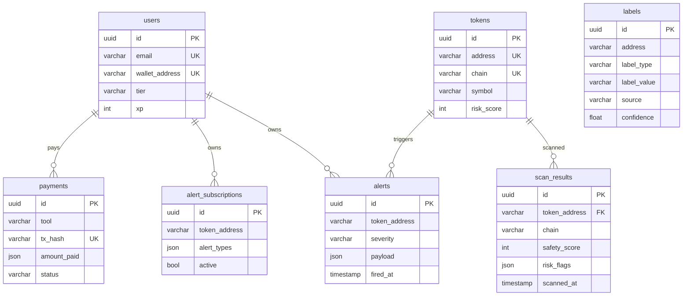

# RMI Fleet Database Schema Reference

> **Last updated:** 2026-07-14  
> **Scope:** All 6 databases in the Rug Munch Media production fleet  
> **File:** SCHEMA.md — infrastructure reference, not application code

---

## 1. PostgreSQL (Primary OLTP)

| Property | Value |
|----------|-------|
| **Container** | `rmi-postgres` |
| **Image** | `postgres:16-alpine` |
| **Port** | `5432` |
| **Host** | `rmi-postgres` (Docker), `talos.rugmunch.io` (external) |
| **Database** | `rmi` |
| **User** | `rmi` (PGPASSWORD in `.secrets/env`) |
| **Credentials** | `PG_URL` / `DATABASE_URL` env var |
| **Backup** | `/root/scripts/backup-postgres.sh` (daily pg_dump to R2) |

### Tables (SQLAlchemy ORM models)

All tables use `UUID` primary keys and inherit `TimestampMixin` (`created_at`, `updated_at`).

#### `users` — platform users

| Column | Type | Constraints |
|--------|------|-------------|
| `id` | `UUID` | PK, default `uuid4()` |
| `email` | `VARCHAR(320)` | UNIQUE, INDEX, nullable |
| `wallet_address` | `VARCHAR(128)` | UNIQUE, INDEX, nullable |
| `role` | `VARCHAR(32)` | DEFAULT `'USER'`, NOT NULL |
| `tier` | `VARCHAR(32)` | DEFAULT `'free'`, NOT NULL |
| `xp` | `INTEGER` | DEFAULT `0`, NOT NULL |
| `level` | `INTEGER` | DEFAULT `1`, NOT NULL |

#### `tokens` — token contract registry

| Column | Type | Constraints |
|--------|------|-------------|
| `id` | `UUID` | PK |
| `address` | `VARCHAR(256)` | INDEX, NOT NULL |
| `chain` | `VARCHAR(32)` | DEFAULT `'solana'`, NOT NULL |
| `name` | `VARCHAR(256)` | DEFAULT `''` |
| `symbol` | `VARCHAR(64)` | INDEX |
| `decimals` | `INTEGER` | DEFAULT `9` |
| `total_supply` | `FLOAT` | DEFAULT `0.0` |
| `circulating_supply` | `FLOAT` | DEFAULT `0.0` |
| `holders` | `INTEGER` | DEFAULT `0` |
| `verified` | `BOOLEAN` | DEFAULT `false` |
| `risk_score` | `INTEGER` | DEFAULT `0` |
| `risk_level` | `VARCHAR(16)` | DEFAULT `'low'` |
| `extra` | `JSON` | nullable |

 Indexes: `UNIQUE(chain, address)` → `uq_token_chain_address`

#### `scan_results` — token safety scan results

| Column | Type | Constraints |
|--------|------|-------------|
| `id` | `UUID` | PK |
| `token_address` | `VARCHAR(256)` | INDEX |
| `chain` | `VARCHAR(32)` | NOT NULL |
| `symbol` | `VARCHAR(64)` | DEFAULT `''` |
| `name` | `VARCHAR(256)` | DEFAULT `''` |
| `safety_score` | `INTEGER` | DEFAULT `50` |
| `risk_score` | `INTEGER` | DEFAULT `0` |
| `risk_level` | `VARCHAR(16)` | DEFAULT `'low'` |
| `risk_flags` | `JSON` | NOT NULL |
| `warnings` | `JSON` | NOT NULL |
| `modules_run` | `JSON` | NOT NULL |
| `extra` | `JSON` | nullable |
| `scanned_at` | `TIMESTAMPTZ` | NOT NULL |
| `tier_required` | `VARCHAR(16)` | DEFAULT `'free'` |
| `confidence` | `INTEGER` | DEFAULT `0` |

 Indexes: `IX(token_address, chain)`, `IX(scanned_at)`

#### `alerts` — fired security alerts

| Column | Type | Constraints |
|--------|------|-------------|
| `id` | `UUID` | PK |
| `token_address` | `VARCHAR(256)` | INDEX |
| `chain` | `VARCHAR(32)` | NOT NULL |
| `alert_type` | `VARCHAR(64)` | NOT NULL |
| `severity` | `VARCHAR(16)` | DEFAULT `'info'` |
| `payload` | `JSON` | nullable |
| `fired_at` | `TIMESTAMPTZ` | NOT NULL |
| `owner_id` | `UUID` | INDEX, nullable |

#### `alert_subscriptions` — user alert subscriptions

| Column | Type | Constraints |
|--------|------|-------------|
| `id` | `UUID` | PK |
| `token_address` | `VARCHAR(256)` | NOT NULL |
| `chain` | `VARCHAR(32)` | NOT NULL |
| `alert_types` | `JSON` | NOT NULL |
| `webhook_url` | `VARCHAR(2048)` | nullable |
| `active` | `BOOLEAN` | DEFAULT `true` |
| `owner_id` | `UUID` | INDEX, nullable |

 Index: `IX(token_address, chain)`

#### `labels` — address labels (Postgres cache, source-of-truth in CH)

| Column | Type | Constraints |
|--------|------|-------------|
| `id` | `UUID` | PK |
| `address` | `VARCHAR(256)` | INDEX |
| `chain` | `VARCHAR(32)` | NOT NULL |
| `label_type` | `VARCHAR(64)` | INDEX |
| `label_value` | `VARCHAR(256)` | NOT NULL |
| `source` | `VARCHAR(64)` | NOT NULL |
| `confidence` | `FLOAT` | DEFAULT `0.5` |
| `entity` | `VARCHAR(256)` | INDEX, nullable |
| `entity_category` | `VARCHAR(64)` | nullable |
| `attributes` | `JSON` | nullable |
| `verified_at` | `TIMESTAMPTZ` | nullable |

 Indexes: `UNIQUE(address, chain, label_type, label_value)` → `uq_label`, `IX(entity)`

#### `payments` — x402 micro-payment receipts

| Column | Type | Constraints |
|--------|------|-------------|
| `id` | `UUID` | PK |
| `tool` | `VARCHAR(128)` | NOT NULL |
| `chain` | `VARCHAR(32)` | NOT NULL |
| `tx_hash` | `VARCHAR(256)` | INDEX, nullable |
| `amount_paid` | `JSON` | nullable |
| `status` | `VARCHAR(32)` | DEFAULT `'pending'` |
| `user_address` | `VARCHAR(128)` | INDEX, nullable |

### PostgreSQL Mermaid ERD



### Key Indexes

| Index | Table | Column(s) | Why |
|-------|-------|-----------|-----|
| `uq_token_chain_address` | `tokens` | `(chain, address)` | Uniqueness per chain |
| `ix_scan_result_token_chain` | `scan_results` | `(token_address, chain)` | Fast token lookup |
| `ix_scan_result_scanned_at` | `scan_results` | `(scanned_at)` | Time-range queries |
| `uq_label` | `labels` | `(address, chain, label_type, label_value)` | Dedup labels |
| `ix_label_entity` | `labels` | `(entity)` | Entity-based lookup |

### Additional Postgres Instances

| Container | Purpose |
|-----------|---------|
| `rmi-trigger-db` | Ponder indexer trigger state |
| `rmi-langfuse-db` | Langfuse observability backend |
| `rmi-temporal-db` | Temporal workflow engine |
| `degenfeed-glitchtip-db` | GlitchTip error tracking |
| `pry-postgres` | Pry scraper state |
| `polymarket-postgres` | Polymarket indexer |

---

## 2. ClickHouse (Analytics OLAP)

| Property | Value |
|----------|-------|
| **Container** | `rmi-clickhouse` |
| **Image** | `clickhouse/clickhouse-server:latest` |
| **Port** | `8123` (HTTP), `9000` (native) |
| **Host** | `rmi-clickhouse` |
| **User** | `default` (CH_PASSWORD in env) |
| **Backup** | `/root/scripts/backup-clickhouse.sh` (daily `BACKUP TABLE` to R2) |

### Databases

| Database | Purpose |
|----------|---------|
| `default` | Langfuse observability + core analytics (wallet_labels, mbal_labels, dex_trades, realcats) |
| `rmi` | RMI product analytics (cost_attribution, mcp_calls, x402_revenue, reputation_deltas, indexer_lag) |
| `rugdex` | DEX aggregator (trades, pairs, holders, OHLCV materialized views) |
| `wallet_memory` | Wallet label propagation (wallet_labels — 39M rows) |
| `rugcharts` | Chart data (pairs) |

### Tables (rmi database)

#### `rmi.mcp_calls` — MCP tool invocation audit

```sql
CREATE TABLE rmi.mcp_calls (
    call_id    String,
    tool_id    String,
    agent_id   String,
    latency_ms UInt32,
    success    UInt8,
    called_at  DateTime
) ENGINE = MergeTree ORDER BY called_at
```

#### `rmi.x402_revenue` — x402 micro-payment revenue

```sql
CREATE TABLE rmi.x402_revenue (
    tx_hash     String,
    tool_id     String,
    agent_id    String,
    amount_usd  Float64,
    chain       String,
    paid_at     DateTime,
    tier        String
) ENGINE = MergeTree PARTITION BY toYYYYMM(paid_at) ORDER BY paid_at
```

#### `rmi.cost_attribution` — per-agent cost tracking

```sql
CREATE TABLE rmi.cost_attribution (
    ts                  DateTime,
    tool_id             String,
    agent_id            String,
    llm_tokens_cents    UInt32,
    rpc_requests_cents  UInt32,
    storage_reads_cents UInt32,
    compute_cents       UInt32,
    price_charged_cents UInt32
) ENGINE = MergeTree PARTITION BY toYYYYMM(ts) ORDER BY (ts, tool_id, agent_id)
```

#### `rmi.reputation_deltas` — deployer reputation changes

```sql
CREATE TABLE rmi.reputation_deltas (
    deployer_id String,
    old_alpha   UInt32,
    old_beta    UInt32,
    new_alpha   UInt32,
    new_beta    UInt32,
    event_type  String,
    updated_at  DateTime
) ENGINE = MergeTree ORDER BY (deployer_id, updated_at)
```

#### `rmi.indexer_lag` — blockchain indexer health

```sql
CREATE TABLE rmi.indexer_lag (
    chain      String,
    block_lag  UInt32,
    last_block UInt64,
    updated_at DateTime
) ENGINE = MergeTree ORDER BY (chain, updated_at)
```

### Key Tables (default database)

| Table | Engine | Rows | Purpose |
|-------|--------|------|---------|
| `wallet_labels` | MergeTree | 132K | Address labels (chain, address, label, name_tag) |
| `mbal_labels` | MergeTree | 10M | Multi-blockchain AML labels |
| `dex_trades` | MergeTree (partitioned monthly) | — | DEX trade logs (chain, dex, pair, price) |
| `realcats_eth` | MergeTree | 16K | Ethereum wallet behavioral profiles |
| `realcats_btc` | MergeTree | 90K | Bitcoin wallet behavioral profiles |

### wallet_memory.wallet_labels

```sql
CREATE TABLE wallet_memory.wallet_labels (
    address         String,
    chain_id        String,
    label_name      String,
    label_category  String,
    source          String,
    is_sanctioned   UInt8 DEFAULT 0,
    loaded_at       DateTime DEFAULT now(),
    label_subtype   String DEFAULT ''
) ENGINE = MergeTree ORDER BY (address, label_name, source)
```
**39 million rows.** Primary source for address label resolution.

### rugdex DEX Aggregator Tables

#### `rugdex.trades` — raw DEX trades

```sql
CREATE TABLE rugdex.trades (
    chain         String,
    pair_address  String,
    token_address String,
    price_usd     Float64,
    amount        Float64,
    volume_usd    Float64,
    is_buy        UInt8,
    trader        String,
    tx_signature  String,
    block_time    DateTime,
    block_slot    UInt64
) ENGINE = MergeTree PARTITION BY toYYYYMM(block_time)
  ORDER BY (chain, token_address, block_time)
```

#### `rugdex.pairs` — DEX pair metadata

```sql
CREATE TABLE rugdex.pairs (
    chain          String,
    pair_address   String,
    token_address  String,
    token_name     String,
    token_symbol   String,
    quote_token    String,
    dex            String,
    created_at     DateTime,
    liquidity_usd  Float64,
    fdv_usd        Float64
) ENGINE = ReplacingMergeTree ORDER BY (chain, pair_address)
```

#### `rugdex.holders` — token holder snapshots

```sql
CREATE TABLE rugdex.holders (
    chain           String,
    token_address   String,
    holder_address  String,
    amount          Float64,
    percentage      Float64,
    snapshot_time   DateTime
) ENGINE = MergeTree ORDER BY (chain, token_address, snapshot_time)
```

### Materialized Views

#### `rugdex.ohlcv_5m` — 5-minute OHLCV candles

Aggregates from `rugdex.trades` using materialized view into an `AggregatingMergeTree`. Uses `argMinState`/`argMaxState`/`sumState`/`countState` for five-minute bucketed OHLCV with volume and trade count. **44,402 rows.** Partitioned monthly, ordered by `(chain, token_address, ts)`.

#### `rugdex.ohlcv_1h` — 1-hour OHLCV candles

Same pattern as `ohlcv_5m` with `toStartOfHour(block_time)` bucketing. **8,108 rows.**

### Backup Strategy

- Daily `clickhouse-client -q "BACKUP TABLE ... TO S3(...)"` via `/root/scripts/backup-clickhouse.sh`
- Wallet labels also backed up via `/srv/work/repos/rmi-backend/scripts/nightly_label_backup.py` (30-day retention to R2)

---

## 3. Neo4j (Graph — Entity Resolution)

| Property | Value |
|----------|-------|
| **Container** | `rmi-neo4j` |
| **Image** | `neo4j:5-enterprise` |
| **Port** | `7687` (Bolt), `7474` (HTTP), `7688` (Bolt Routing) |
| **Host** | `rmi-neo4j` |
| **User** | `neo4j` |
| **Password** | `NEO4J_PASSWORD` (in `.secrets/env`) |
| **Sync cron** | `neo4j-sync` every 6 hours |
| **Backup** | `/root/scripts/backup-neo4j.sh` (`neo4j-admin database dump`) |

### Node Labels

| Label | Description | Properties |
|-------|-------------|------------|
| `Entity` | Logical entity resolved across chains | `entity_id`, `label`, `aliases`, `first_seen`, `last_seen`, `risk_score`, `tags` |
| `Wallet` | On-chain wallet (primary node type) | `wallet_id` ("chain:address"), `chain`, `address`, `entity_id`, `first_seen`, `last_seen`, `tx_count`, `total_volume_usd`, `is_deployer`, `is_known_exchange`, `is_suspicious`, `reputation_score` |
| `Deployer` | Wallet that deployed ≥1 token | Inherits Wallet + `deployments[]`, `rug_count`, `legit_count`, `avg_token_lifetime_days` |
| `Contract` | Smart contract address | `contract_id` ("chain:address"), `chain`, `address`, `entity_id`, `type` (token, dex, bridge, etc.) |

### Relationship Types

| Type | Direction | Description | Properties |
|------|-----------|-------------|------------|
| `SAME_AS` | Bidirectional | Same entity, same wallet | `confidence` (0.0–1.0) |
| `FUNDED_BY_SAME` | Bidirectional | Funded by same source wallet | `confidence` |
| `CLONE_OF` | Directed | Contract is a clone of another | `confidence`, `similarity` |
| `BEHAVIORAL_MATCH` | Bidirectional | Similar on-chain behavior | `confidence`, `similarity` |
| `DEPLOYED` | Wallet → Contract | Wallet created this contract | `block_number`, `timestamp` |
| `OWNS` | Entity → Wallet | Entity controls this wallet | `role` (owner, creator, etc.) |
| `INTERACTS_WITH` | Wallet → Contract | Wallet has called this contract | `tx_count`, `last_interaction` |

### Key Queries

**Entity resolution (cross-chain):**
```cypher
MATCH path = (start:Wallet {wallet_id: $id})-[:SAME_AS|FUNDED_BY_SAME|CLONE_OF|BEHAVIORAL_MATCH*1..3]-(other:Wallet)
WHERE start <> other
RETURN start.entity_id AS entity_id,
       collect({wallet_id: other.wallet_id, chain: other.chain}) AS wallets,
       reduce(conf = 1.0, r IN relationships(path) | conf * r.confidence) AS confidence
ORDER BY confidence DESC
```

**Find rug-pulling deployers:**
```cypher
MATCH (w:Deployer) WHERE w.rug_count >= $min RETURN w.wallet_id LIMIT 200
```

### Schema Design Notes

- `wallet_id` uses convention `chain:address` (e.g., `solana:7Np41...`) — matches Postgres cross-store reference
- Entity resolution uses path-weighted confidence aggregation across 4 edge types
- Deployer reputation: `legit_count * 1.0 - rug_count * 3.0 + age_bonus - news_penalty` (0–100, cached in Redis)

---

## 4. Qdrant (Vector Search)

| Property | Value |
|----------|-------|
| **Container** | `rmi-qdrant` |
| **Image** | `qdrant/qdrant:latest` |
| **Port** | `6333` (REST), `6334` (gRPC) |
| **Host** | `rmi-qdrant` |
| **Backup** | Qdrant snapshot API |

### Collections (20 total)

All collections share:
- **Vector size:** 1024
- **Distance:** Cosine
- **HNSW config:** `m=16`, `ef_construct=100`
- **Shard number:** 1
- **Replication factor:** 1
- **On-disk payload:** true

| Collection | Purpose | Points |
|-----------|---------|--------|
| `contract_audits` | Contract audit report embeddings | 0 |
| `crime_reports` | Crime report embeddings | 0 |
| `crypto_terms` | Crypto terminology vectors | 0 |
| `defi_hacks` | DeFi hack incident embeddings | 0 |
| `forensic_reports` | Forensic analysis embeddings | 0 |
| `known_scams` | Known scam pattern vectors | 0 |
| `market_intel` | Market intelligence embeddings | 0 |
| `news_articles` | News article embeddings | 0 |
| `rmi_agent_memory` | AI agent conversation memory | 0 |
| `rmi_community` | Community data embeddings | 0 |
| `rmi_knowledge` | General RMI knowledge base | 0 |
| `rmi_news` | RMI-specific news vectors | 0 |
| `rug_timeline` | Rug pull timeline embeddings | 0 |
| `scam_patterns` | Scam pattern analysis vectors | 0 |
| `threat_intel` | Threat intelligence vectors | 1 |
| `token_analysis` | Token analysis embeddings | 0 |
| `token_security` | Token security vectors | 0 |
| `transaction_patterns` | Transaction pattern vectors | 0 |
| `vuln_patterns` | Vulnerability pattern vectors | 0 |
| `wallet_profiles` | Wallet profile embeddings | 0 |

> Points currently low; data is ingested by the RAG pipeline on `/srv/work/repos/rmi-backend/app/rag/`.

### Canonical RAG Collections (13 — from catalog/models.py)

```
scam_intel, deployer_history, wallet_labels, contract_audit,
phishing_db, defi_hacks, rug_timeline, vuln_patterns,
crime_reports, transaction_patterns, known_scams,
token_analysis, market_intel
```

### Payload Schema (per collection)

Payloads vary by collection but generally include:
- `source` (String) — data provenance
- `token_id` / `wallet_id` (String) — cross-store ref to Postgres/Neo4j
- `timestamp` (DateTime) — when ingested
- `metadata` (JSON) — collection-specific attributes

### Integration

- **RAG engine** (`app/rag/llama_adapter.py`): uses `LlamaIndex` + `QdrantVectorStore`
- **CatalogService** (`app/catalog/service.py`): Qdrant client via `httpx.AsyncClient` to `http://rmi-qdrant:6333`
- **Similar token search**: vector similarity on token_analysis collection
- **RAG finding storage**: `RAGFinding` model stores `qdrant_point_id` cross-ref

---

## 5. Redis / Dragonfly (Cache + Queue + Pub/Sub)

| Property | Value |
|----------|-------|
| **Container** | `rmi-redis` |
| **Image** | `docker.dragonflydb.io/dragonflydb/dragonfly` |
| **Port** | `6379` |
| **Host** | `rmi-redis` |
| **DB** | `0` |
| **Password** | `REDIS_PASSWORD` (in `.env.runtime`) |
| **Pool** | Max 20 connections, health check every 30s |
| **Backup** | `/root/scripts/backup-redis.sh` (`SAVE` + copy to R2) |

### Key Patterns

| Pattern | Type | Purpose | TTL |
|---------|------|---------|-----|
| `rmi:task_queue` | LIST | Background task queue (brpop) | — |
| `rmi:task_queue:delayed` | ZSET | Delayed/scheduled tasks | — |
| `rmi:task_queue:dead` | LIST | Dead letter queue for failed tasks | — |
| `rmi:cache:*` | STRING | Generic data cache (various prefixes) | Variable |
| `catalog:risk:{chain}:{address}` | STRING | Token risk score cache | 60s |
| `rmi:dev:key:{hash}` | STRING | Developer API key data | — |
| `rmi:dev:usage:{hash}:{date}` | STRING | Daily API call counters | — |
| `rmi:dev:usage:{hash}:total` | STRING | Lifetime API call counters | — |
| `rmi:dev:ratelimit:{hash}:{minute}` | STRING | Per-minute rate limit counter | 60s |
| `rmi:dev:stats:*` | STRING | Aggregate dev portal stats | — |
| `rmi:dev:email:{email}` | SET | API keys per email | — |
| `rmi:scan_usage:{date}:{type}:{id}` | STRING | Daily scan rate limiter | — |
| `rmi:wallet:wallet:{chain}:{address}` | STRING | Wallet data cache | — |
| `rmi:wallet:stats:*` | STRING | Wallet verification stats | — |
| `rmi:status:*` | STRING | Service health status cache | 120s |
| `rmi:facilitator:{name}:payment_*` | STRING | Payment facilitator metrics | — |
| `rag:pattern_cache:{name}` | STRING | RAG pattern match cache | — |
| `rmi:tool:*` | STRING | Tool-specific state | — |

### Data Structures

| Structure | Used For |
|-----------|----------|
| **LIST** | Task queue (`lpush`/`brpop`), dead letter queue |
| **ZSET** | Delayed tasks (score = timestamp), sorted metrics |
| **SET** | Email-to-key mapping, membership sets |
| **STRING** | Cache entries, counters, rate limiters, key data |
| **HASH** | (Available but not yet primary pattern — prefer STRING) |
| **PUB/SUB** | (Available for real-time alerts, not yet heavily used) |

### Rate Limiting Strategy

- **Scan rate limit:** Daily counters via `rmi:scan_usage:{date}:{identity_type}:{identity}` (Redis INCR)
- **Dev portal rate limit:** Per-minute sliding window via `rmi:dev:ratelimit:{key}:{minute}` (INCR + EXPIRE)
- **Protection middleware:** `SimpleRateLimiter` with per-client windows (60 req/30s for scans, 30 req/60s for labels)
- **Tier-based limits:** `free=100/day`, `pro=10k/day`, `enterprise=unlimited`

### Queue Architecture

The internal task queue (not Celery) uses Redis-backed pattern:
1. `enqueue()` → `LPUSH rmi:task_queue <json_task>`
2. `_processor_loop()` → `BRPOP rmi:task_queue timeout=5`
3. Failed tasks → `ZADD rmi:task_queue:delayed` for retry
4. Exhausted retries → `LPUSH rmi:task_queue:dead`

---

## 6. DuckDB (Embedded Analytics)

| Property | Value |
|----------|-------|
| **Type** | Embedded (in-process, like SQLite) |
| **Module** | `app/core/duckdb_analytics.py` — `DuckDBAnalytics` class |
| **Default** | In-memory (`:memory:`) — no persistence |
| **Persist path** | Optional: `/var/lib/duckdb/rmi.db` |
| **Library** | `duckdb` (Python, lazily imported) |
| **Backup** | Not needed (transient/ephemeral use; data source is Parquet or Postgres) |

### Why DuckDB, Not ClickHouse

> Per RMI v5 §T13 / §T31: DuckDB handles sub-1GB analytical queries in-process at 10× the speed of ClickHouse with zero infrastructure. ClickHouse is reserved for large-scale (multi-GB) analytical workloads.

### Usage Patterns

| Pattern | Method | Description |
|---------|--------|-------------|
| In-memory SQL | `db.query(sql)` | Fast ad-hoc analytics, no persistence |
| Postgres join | `db.query_postgres(sql)` | ATTACH postgres://... AS pg READ_ONLY, cross-DB joins |
| Parquet query | `db.query_parquet(path, sql)` | Query exported Parquet/CSV from MinIO with zero ETL |
| DataFrame register | `db.register_dataframe(name, df)` | Query pandas/polars DataFrames as tables |
| Export to Parquet | `db.export_to_parquet(sql, path)` | COPY (SELECT ...) TO 'file.parquet' (FORMAT PARQUET) |
| Table inspection | `db.list_tables()`, `db.table_exists(name)` | Schema introspection |

### Where It's Used

| File | What It Does |
|------|-------------|
| `app/core/duckdb_analytics.py` | Core `DuckDBAnalytics` class (274 lines) |
| `app/databus/duckdb_analytics.py` | DataBus integration for offloaded analytics |
| `app/domains/labels/sources/ethereum_labels_csv.py` | Query Ethereum CSV labels via DuckDB |
| `app/domains/labels/sources/solana_labels_csv.py` | Query Solana CSV labels via DuckDB |
| `app/domains/labels/sources/etherscan_csv.py` | Query Etherscan CSV data |
| `app/mcp/server.py` | MCP server `analytics_query` tool (uses DuckDB) |

### Typical Queries

```sql
-- Simple aggregation
SELECT chain, count(*) AS n FROM tokens WHERE deployed_at > ? GROUP BY chain

-- Cross-DB join (Postgres + DuckDB)
SELECT t.chain, count(*) AS n FROM pg.tokens t GROUP BY t.chain

-- Parquet query (no ingestion)
SELECT count(*) AS n FROM read_parquet('/tmp/export.parquet')

-- Export results
COPY (SELECT * FROM scan_results WHERE risk_level = 'critical')
  TO '/tmp/critical_scans.parquet' (FORMAT PARQUET)
```

### Example (from solana_labels_csv.py)

```python
from app.core.duckdb_analytics import DuckDBAnalytics

d = DuckDBAnalytics()
rows = d.query("SELECT address, label FROM parquet WHERE chain = ?", ["solana"])
```

---

## Cross-Store Reference Summary

| Entity Type | Primary Store | Cross-Store ID | Referenced By |
|-------------|--------------|----------------|---------------|
| Token | Postgres | `chain:address` | Neo4j (`Deployer.deployments`), Qdrant (`rag_embedding_id`) |
| Wallet | Neo4j | `chain:address` | Postgres (`tokens.deployer_wallet_id`), Redis (`rmi:wallet:wallet:*`) |
| Entity | Neo4j | UUID4 | Neo4j Wallet (`entity_id`), Postgres labels (`entity`) |
| RAG Finding | Qdrant | 16-byte UUID hex | Postgres (`rag_embedding_id`) |
| Alert | Postgres | UUID4 | — |
| Scan Report | Postgres (+ MinIO) | UUID4 | — |

### Data Flow (Request Paths)

```
User request
  → Redis cache lookup (fast path)
    → Miss → Postgres primary (users, tokens, scans, payments)
    → If entity resolution → Neo4j (Wallet → Entity graph)
    → If RAG similarity → Qdrant (vector search)
    → If analytics → ClickHouse (large aggregations)
                  → DuckDB (small ad-hoc queries)
  → Cache result in Redis
  → Return response
```

### Backup Scripts

| Scripture | Frequency | Target |
|-----------|-----------|--------|
| `/root/scripts/backup-postgres.sh` | Daily | R2 (pg_dump) |
| `/root/scripts/backup-clickhouse.sh` | Daily | R2 (BACKUP TABLE) |
| `/root/scripts/backup-neo4j.sh` | Daily | R2 (neo4j-admin dump) |
| `/root/scripts/backup-redis.sh` | Daily | R2 (SAVE + copy) |
| `/srv/work/repos/rmi-backend/scripts/nightly_label_backup.py` | Daily | R2 (label data, 30-day retention) |
| `/root/scripts/degenfeed-backup.sh` | Daily | R2 (Mastodon Postgres + media) |
